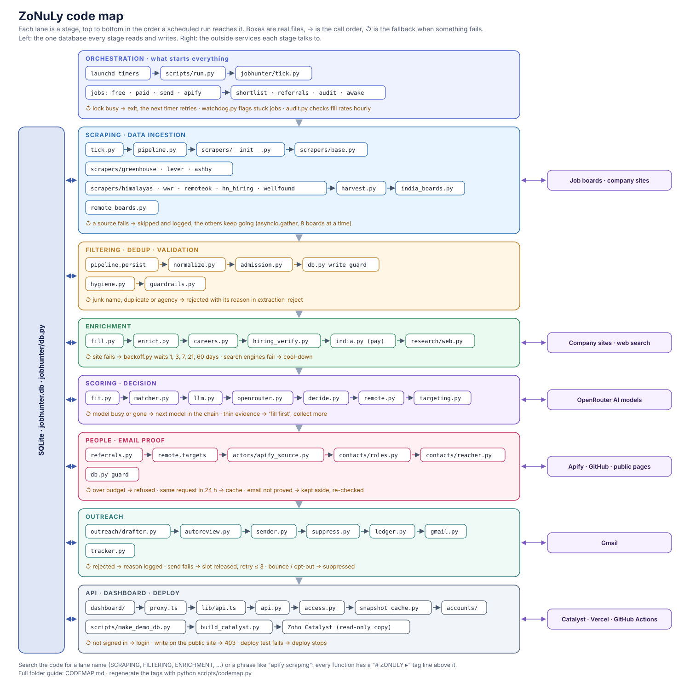

# ZoNuLy code map

Which folder does what, where every important file lives, and how data moves from one file to the next. `node_modules/`, `docs/` and `tests/` are left out on purpose.



The picture above is `CODEMAP.svg`: each lane is a stage, the boxes are the real files in call order, the database is on the left and the outside services are on the right. ↺ marks what happens when something fails.

**Search tags above every function.** Every function and class has one comment line right above it, starting with `# ZONULY ▸`, which lists search phrases, its stage, its full name and what it does. For example:

```python
# ZONULY ▸ apify scraping · apify people search · people search · referrers ▸ people · referrer pipeline ▸ referrals.apify_step(): Buy up to `limit` companies' People tabs ...
def apify_step(limit: int = 1, ...):
```

In VS Code press **Ctrl/Cmd + Shift + F** and type a phrase such as `apify scraping`, `himalayas scraping`, `admission gate`, `email verification`, `email sending`, `api route GET /api/companies` or `retry · backoff`. Every hit is the line directly above the function that does that job.

**How to read a path.** `ZoNuLy → jobhunter → scrapers → greenhouse.py` means: open the repo folder `ZoNuLy`, then the folder `jobhunter`, then `scrapers`, and the file is `greenhouse.py`.

**How to search the code.** Every Python file starts with a generated block headed `ZONULY CODE MAP`. It shows the file's full path, its stage, which files call it, which files it calls, and every function with one line on what it does. Search for a stage word to find every file in that stage:

| Search for | Finds |
|---|---|
| `SCRAPING` | every job-board scraper and the scraping orchestration |
| `DATA INGESTION` | everything that brings data in: scrapers, discovery, lists, resume |
| `FILTERING` | normalization, admission gate, guardrails, dedup, cleanup |
| `ENRICHMENT` | company fill, facts, careers pages, hiring checks, pay, research |
| `SCORING` / `DECISION` | fit gate, AI judge, decision model, targeting, remote targets |
| `PEOPLE` | contact discovery, Apify, email proof |
| `OUTREACH` | drafting, review, sending, replies, CSV export |
| `API` | FastAPI routes, access control, sign-in, caching |
| `ORCHESTRATION` | the scheduled jobs |
| `ZONULY CODE MAP` | the header of every file |

The headers are written by `ZoNuLy → scripts → codemap.py`. Run `python scripts/codemap.py` again after adding a file or a function.

---

## 1. The top-level folders

```
ZoNuLy/
├── jobhunter/         the Python backend: every pipeline stage, the API, the database   (§2)
├── scripts/           command-line tools: the CLI, CSV exports, sprints, deploy builds  (§3)
├── dashboard/         the Next.js website you open in the browser                      (§4)
├── knowledge/         the knowledge graph's seed (context.yaml) and the generated BRIEF.md
├── system docs/       design documents and plans (FINAL-PLAN-V3.md, REMOTE-TODO.md, ...)
├── deploy/catalyst/   config for the public API on Zoho Catalyst AppSail
├── tools/             external helpers: reacher/ (email checker binary), paperclip/ (developer agents)
├── .github/workflows/ CI/CD: snapshot.yml tests, builds and deploys on every merge to main
├── data/              runtime files (not in git): lock files, Apify cache, CSV hand-offs, backups
├── logs/              one log per scheduled job (not in git)
├── profile/           the resume as structured profile.json, plus the resume PDFs
├── Resume/            the current resume PDF
├── pitch/             a pitch deck and its screenshots
├── reports/           one-off company dossiers
├── outbox/            saved .eml copies of notification mails
├── assets/            images used by the README and pitch
├── external/          third-party reference projects (not imported by the app)
├── config.yaml        every limit, threshold, model name and switch, each change dated
├── companies.yaml     the hand-picked company registry with their job-board slugs
├── pyproject.toml     Python dependencies (uv.lock pins exact versions)
├── docker-compose.yml optional container run
├── jobhunter.db       the live SQLite database (never in git)
├── demo.db.gz         the stripped read-only copy the public site serves
├── CLAUDE.md          working rules for the AI coding agent
└── README.md          project overview
```

---

## 2. `jobhunter/`, the backend, by stage

### 2.1 Orchestration: what starts everything
| File | Path | What it does |
|---|---|---|
| tick.py | ZoNuLy → jobhunter → tick.py | The scheduled jobs. `run(kind)` takes a lock and runs one bounded slice: `run_free` (scrape, fill, people), `run_paid`, `run_send`, `run_apify`, `run_shortlist` |
| scheduler.py | ZoNuLy → jobhunter → scheduler.py | APScheduler loop that runs while the API server is up |
| watchdog.py | ZoNuLy → jobhunter → watchdog.py | Flags a job that is stuck and silent |
| audit.py | ZoNuLy → jobhunter → audit.py | Hourly data-quality report (fill rates now vs 1 h vs 24 h) |

launchd (`~/Library/LaunchAgents/com.zonuly.*.plist`) runs `scripts/run.py tick run --kind …`, which calls `jobhunter/tick.py`.

### 2.2 Scraping and data ingestion
| File | Path | What it does |
|---|---|---|
| pipeline.py | ZoNuLy → jobhunter → pipeline.py | **The ingestion pipeline.** `scrape()` runs every enabled scraper at once (`scrape_async`, asyncio), then `persist()` filters, dedups and writes jobs |
| scrapers/__init__.py | ZoNuLy → jobhunter → scrapers → \_\_init\_\_.py | The scraper registry: source name → module; `get_fetcher(name)` |
| scrapers/base.py | ZoNuLy → jobhunter → scrapers → base.py | Shared plumbing: `RawJob`, `make_client()` (HTTP client), `gather_limited()` (8 at a time), HTML → text |
| scrapers/greenhouse.py, lever.py, ashby.py | ZoNuLy → jobhunter → scrapers → … | Public job-board APIs of companies' own career pages |
| scrapers/himalayas.py | ZoNuLy → jobhunter → scrapers → himalayas.py | Remote jobs open to India (`country=India`) |
| scrapers/wwr.py, remoteok.py, hn_hiring.py, wellfound.py, freehire.py, yc.py | ZoNuLy → jobhunter → scrapers → … | Job boards and feeds |
| scrapers/careers_ats.py, discover.py | ZoNuLy → jobhunter → scrapers → … | Recognise a careers page or hosted board; find which board a company uses |
| scrapers/funding_rss.py, india_jobs.py | ZoNuLy → jobhunter → scrapers → … | Funding news feeds; India job-board parsers |
| harvest.py | ZoNuLy → jobhunter → harvest.py | Company discovery: funding feeds, YC, search; then `probe_ats()` and `scrape_roles()` |
| india_boards.py, india_sources.py, india_jobs.py | ZoNuLy → jobhunter → … | Discover Bengaluru / Hyderabad companies |
| remote_boards.py, communities.py | ZoNuLy → jobhunter → … | Remote boards; public Slack/Discord communities |
| lists.py, onboard.py | ZoNuLy → jobhunter → … | Hand-picked lists; add one company by hand |
| resume.py | ZoNuLy → jobhunter → resume.py | Resume PDF → `profile/profile.json` |

### 2.3 Filtering and validation
| File | Path | What it does |
|---|---|---|
| normalize.py | ZoNuLy → jobhunter → normalize.py | `title_relevant`, `location_ok`, `fingerprint` (dedup), salary → LPA, `remote_from_india`, `is_senior` |
| admission.py | ZoNuLy → jobhunter → admission.py | **The admission gate**: `admit()` decides whether a company may be created (real name, real site, not a duplicate, not an agency) |
| guardrails.py | ZoNuLy → jobhunter → guardrails.py | Validates every extracted field and stores it with evidence |
| hygiene.py | ZoNuLy → jobhunter → hygiene.py | Dedup and cleanup of the company registry, every tick |
| backoff.py | ZoNuLy → jobhunter → backoff.py | Retry waits (1, 3, 7, 21, 60 days) for failing steps |
| db.py (write guards) | ZoNuLy → jobhunter → db.py | `before_flush` listeners refuse unproved or guessed email addresses on every save |

### 2.4 Data enrichment
| File | Path | What it does |
|---|---|---|
| fill.py | ZoNuLy → jobhunter → fill.py | Completes one company at a time: homepage, description, careers page, LinkedIn link |
| enrich.py | ZoNuLy → jobhunter → enrich.py | Finds official websites; funding facts; descriptions via the AI |
| careers.py | ZoNuLy → jobhunter → careers.py | Finds a careers page and its open roles |
| hiring_verify.py | ZoNuLy → jobhunter → hiring_verify.py | Checks a hiring claim against the company's own site |
| india.py | ZoNuLy → jobhunter → india.py | ₹20 LPA pay floor, `pay_proved()`, India discovery |
| levels.py, interviews.py, segments.py, ways_in.py, skills.py, needs.py | ZoNuLy → jobhunter → … | Pay data, interview info, market segment, public ways in, skill dictionary, needs analysis |
| research/ | ZoNuLy → jobhunter → research → … | Web search (`web.py`), GitHub, Reddit, YouTube, X, a TTL cache |

### 2.5 Scoring and decisions
| File | Path | What it does |
|---|---|---|
| fit.py | ZoNuLy → jobhunter → fit.py | Free word-overlap score (rare words count more), the gate before any AI call |
| matcher.py | ZoNuLy → jobhunter → matcher.py | AI judge on the jobs that pass the gate |
| llm.py, openrouter.py | ZoNuLy → jobhunter → … | The only model client: role aliases, fallback chain, cost ledger |
| confidence.py | ZoNuLy → jobhunter → confidence.py | Selection confidence per role (India and remote profiles) |
| decide.py | ZoNuLy → jobhunter → decide.py | Decision brain: P(offer) with a range, or "fill first" |
| targeting.py, mixer.py, shortlist.py, focus.py | ZoNuLy → jobhunter → … | Grades and priority, the mixer, shortlist completion, the daily focus |
| remote.py | ZoNuLy → jobhunter → remote.py | Remote-from-India targets |

### 2.6 People and email proof
| File | Path | What it does |
|---|---|---|
| referrals.py | ZoNuLy → jobhunter → referrals.py | The people step, the Apify queue (`apify_queue`), Hunter, re-verification |
| contacts/ | ZoNuLy → jobhunter → contacts → … | `github_miner`, `team_people`, `linkedin_public`, `site_scraper` (find people); `roles` (classify); `affiliation` (still there?); `reacher` (prove the email) |
| actors/ | ZoNuLy → jobhunter → actors → … | `apify_source.py` (budget-gated Apify People tab), `people.py`, `core.py`, `fill.py` |

### 2.7 Outreach
| File | Path | What it does |
|---|---|---|
| outreach/drafter.py | ZoNuLy → jobhunter → outreach → drafter.py | Writes the referral email from real facts |
| outreach/autoreview.py, gates.py | ZoNuLy → jobhunter → outreach → … | Rules approve or reject each draft, with a reason |
| outreach/sender.py | ZoNuLy → jobhunter → outreach → sender.py | Sends approved mail inside the window: `send_due()`, `send_email()` |
| outreach/ledger.py | ZoNuLy → jobhunter → outreach → ledger.py | The daily cap: `reserve()` / `release()` under a lock |
| outreach/suppress.py | ZoNuLy → jobhunter → outreach → suppress.py | Bounces, opt-outs, cooldowns |
| outreach/gmail.py, mailbox.py, inboxes.py | ZoNuLy → jobhunter → outreach → … | Gmail API and SMTP/IMAP transport, the sending inboxes |
| outreach/tracker.py, followup.py, schedule.py | ZoNuLy → jobhunter → outreach → … | Read and classify replies, one follow-up, put meetings on the calendar |
| outreach/handoff.py | ZoNuLy → jobhunter → outreach → handoff.py | Numbered CSV hand-offs |

### 2.8 The API: how and where it runs
| File | Path | What it does |
|---|---|---|
| api.py | ZoNuLy → jobhunter → api.py | **The FastAPI app**: 113 routes the dashboard calls, middleware, background tasks |
| access.py | ZoNuLy → jobhunter → access.py | Access middleware: 401 when not signed in, 403 for writes or private pages on the public site |
| accounts/ | ZoNuLy → jobhunter → accounts → … | Sign-in: `routes.py` (`/api/auth/*`), `tokens.py` (signed cookies), `mail.py` (6-digit code), `store.py` (`AccountStore`) |
| snapshot.py, snapshot_cache.py | ZoNuLy → jobhunter → … | Public copy version check; in-memory response cache |
| outreach/routes.py, research/routes.py, kg/routes_warm.py | ZoNuLy → jobhunter → … | Extra route groups mounted on the app |

**How it runs.**
- **On your laptop:** `python scripts/run.py serve` → `jobhunter/api.py → serve()` → uvicorn on `127.0.0.1:8000`. The app's startup hook (`lifespan`) also starts the scheduler (`jobhunter/scheduler.py`). The dashboard (`cd dashboard && npm run dev`, port 3000) calls `http://127.0.0.1:8000/api/...`.
- **Deployed:** GitHub Actions runs `scripts/build_catalyst.py`, which writes a `start.sh` that sets `ZONULY_PUBLIC=1` and runs `uvicorn jobhunter.api:app` on Zoho Catalyst AppSail, serving the read-only `demo.db`. The dashboard on Vercel calls `/zapi/api/...`, which `dashboard/next.config.ts` rewrites to the Catalyst API.

### 2.9 Storage, config, knowledge graph
| File | Path | What it does |
|---|---|---|
| db.py | ZoNuLy → jobhunter → db.py | SQLModel tables, the engine (WAL mode), write guards |
| \_\_init\_\_.py | ZoNuLy → jobhunter → \_\_init\_\_.py | Loads `config.yaml` once as `CONFIG` |
| kg/ | ZoNuLy → jobhunter → kg → … | Knowledge graph: `store.py`, `sync.py` (tables → graph), `brief.py` (BRIEF.md), `warm.py`, `analyze.py` |
| graphmap.py, network.py | ZoNuLy → jobhunter → … | Graph and atlas data for the dashboard |

---

## 3. `scripts/`
| File | Path | What it does |
|---|---|---|
| run.py | ZoNuLy → scripts → run.py | **The CLI** every command and every scheduled job goes through (`serve`, `scrape`, `tick run`, `kg …`) |
| export_referrals_csv.py | ZoNuLy → scripts → export_referrals_csv.py | The mail-merge CSV (proved addresses, never already sent; `--remote`) |
| verified_sprint.py, remote_fill.py | ZoNuLy → scripts → … | Apify sprint; website and LinkedIn fill for remote targets |
| make_demo_db.py, build_catalyst.py, smoke.py | ZoNuLy → scripts → … | Public snapshot, deploy build, smoke tests |
| cleanup_companies.py, dedupe_contacts.py, revalidate.py | ZoNuLy → scripts → … | Cleanup and re-validation |
| email_audit*.py, try_verify.py, verify_queue.py | ZoNuLy → scripts → … | Email proof audits |
| codemap.py | ZoNuLy → scripts → codemap.py | Writes the code-map header into every Python file |

---

## 4. `dashboard/`, the website
```
dashboard/
├── app/(app)/       one folder per page: companies, roles, leads, graph, atlas, upskill, ...
├── app/login/       sign-in page
├── app/docs/        the in-app documentation pages
├── components/      shared UI pieces (navigation, charts, graph canvas, sign-in gate)
├── lib/api.ts       the one place the website calls the API
├── proxy.ts         runs before every page: checks the signed session cookie
└── next.config.ts   the /zapi → API rewrite used on Vercel
```

---

## 5. End to end, file to file
1. **Start:** `launchd` → `scripts/run.py` → `jobhunter/tick.py`
2. **Scrape:** `pipeline.scrape` → `scrapers/*` (in parallel)
3. **Filter:** `pipeline.persist` → `normalize.py` → `admission.py` → `db.py`
4. **Clean up:** `hygiene.py` → `guardrails.py`
5. **Enrich:** `fill.py` / `enrich.py` / `careers.py` / `hiring_verify.py`
6. **Score:** `fit.py` → `matcher.py` (→ `llm.py` → `openrouter.py`)
7. **Decide:** `decide.py`, `remote.py`
8. **People:** `referrals.py` → `contacts/*`, `actors/apify_source.py` → `contacts/reacher.py` → `db.py` (the email guard)
9. **Outreach:** `outreach/drafter.py` → `outreach/autoreview.py` → `outreach/sender.py` → `outreach/ledger.py` → `outreach/gmail.py` → `outreach/tracker.py`
10. **Read it:** `dashboard/` → `/api/*` → `jobhunter/api.py` → `db.py`

For the diagrams and design reasoning, see `docs/system-design/`, especially `11-architecture-and-code-flow.md`.
