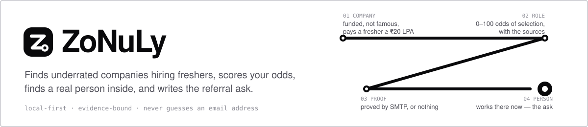
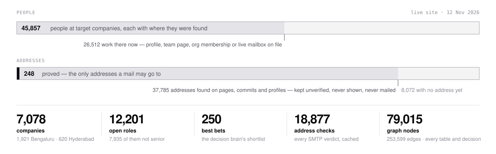
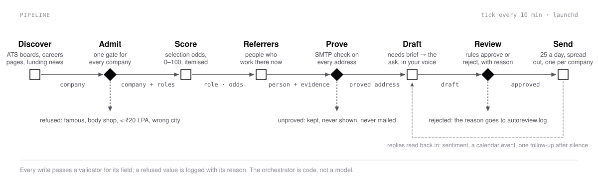
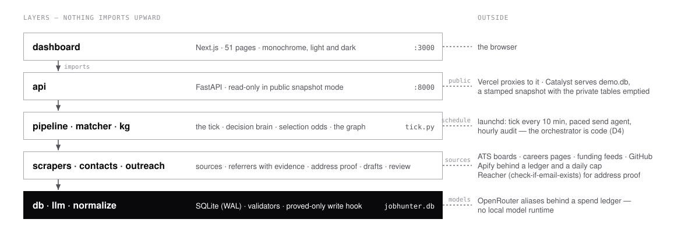

<p align="center">
  <picture>
    <source media="(prefers-color-scheme: dark)" srcset="docs/assets/banner-dark.svg">
    
  </picture>
</p>

<p align="center">
  
  
  
  
  
  
  <a href="https://github.com/Tejmul/Zonuly/actions"></a>
</p>

<p align="center">
  <b>A careers page puts you in a pile of ten thousand. One person inside the company skips the pile entirely.</b><br>
  ZoNuLy finds that person.
</p>

<p align="center">
  <sub>Built by one final-year student who got tired of applying into the void.</sub>
</p>

---

<table align="center">
<tr>
<td align="center" width="33%"><h3>50,204</h3><sub>people found who could refer you</sub></td>
<td align="center" width="33%"><h3>6,823</h3><sub>companies worth asking</sub></td>
<td align="center" width="33%"><h3>248</h3><sub>addresses it will actually use</sub></td>
</tr>
</table>

<p align="center">
  <b>That last number is not a bug. It is the entire point.</b><br>
  <sub>Most outreach tools would mail all 50,204. This one refuses to send a single message it cannot prove will arrive.</sub>
</p>

---

## Why it exists

Four internships in, and the pattern was always the same: the applications that went into a careers
page disappeared, and the ones that came through a human got answered within a day.

So the problem was never *writing applications*. It was finding the humans — the right engineer, at
the right company, who is still there, whose address actually works — a few thousand times over,
without lying to any of them.

That is a data problem wearing a motivation problem's clothes. This is the data system.

<table>
<tr><td><b>Nov 2026</b></td><td>50,204 people found · 248 proved reachable · 177 asked · and the author is still looking</td></tr>
</table>

> The honesty of the third number is the reason the first two are worth anything.

---

## Contents

- [Why it exists](#why-it-exists)
- [By the numbers](#by-the-numbers)
- [How it works](#how-it-works)
- [What makes it different](#what-makes-it-different)
- [The hard parts](#the-hard-parts)
- [Guarantees that are never traded away](#guarantees-that-are-never-traded-away)
- [The dashboard](#the-dashboard)
- [Architecture](#architecture)
- [Getting started](#getting-started)
- [Everyday commands](#everyday-commands)
- [The knowledge graph](#the-knowledge-graph)
- [Configuration](#configuration)
- [Project layout](#project-layout)
- [Public demo](#public-demo)
- [Roadmap](#roadmap)

---

## By the numbers

<p align="center">
  <picture>
    <source media="(prefers-color-scheme: dark)" srcset="docs/assets/numbers-dark.svg">
    
  </picture>
</p>

| | Count | What it means |
|---|---:|---|
| **Leads** | **50,204** | People at target companies, each stored with where and how they were found |
| Confirmed current staff | 24,119 | Verified- or likely-current, with the evidence (profile, team page, org membership, live mailbox) |
| Companies | 6,823 | 1,837 in **Bengaluru** · 575 in **Hyderabad** · the rest remote / abroad |
| Open roles | 11,230 | 7,330 of them not senior — the fresher roles are what ZoNuLy hunts |
| Communities | 107 | Slack and Discord rooms that post jobs, 39 with a job channel, found from public directories |
| **Proved addresses** | **248** | SMTP-proved, delivered-to, or vendor SMTP-verified — the only addresses a mail may go to |
| Addresses found, unproved | 34,136 | Seen on a page, a commit or a profile — kept as evidence, never shown, never mailed |
| Address checks on record | 18,724 | Every verdict from [check-if-email-exists](https://github.com/reacherhq/check-if-email-exists), cached |
| Interview reports | 49 | Glassdoor, Reddit and blog write-ups turned into prep on the company page |

> Counts are read from the live database on 5 Nov 2026. The gap between *leads* and *proved addresses* is deliberate:
> an address is only used once something proves it works — see [what makes it different](#what-makes-it-different).

**That gap is also the project's hardest open problem.** 34,136 addresses are on file and 248 are
usable, because outbound port 25 is blocked on the machine that runs this, so the local SMTP prover
answers `unknown` to almost everything. The addresses are not the bottleneck; the prover is.
`scripts/try_verify.py` tests whether a given network can verify at all and refuses to run when it
cannot, and `scripts/verify_queue.py` exports the best addresses for any bulk verifier's free tier
and reads the result back in. Nothing is ever marked verified because it would be convenient.

---

## How it works

<p align="center">
  <picture>
    <source media="(prefers-color-scheme: dark)" srcset="docs/assets/pipeline-dark.svg">
    
  </picture>
</p>

| Stage | What happens |
|---|---|
| **Discover** | Funded, *underrated* startups and their open roles: ATS boards (Greenhouse, Lever, Ashby, Keka, Darwinbox, Zoho Recruit, Workable …), company careers pages, funding news, public LinkedIn job postings, India startup directories. |
| **Admission + guardrails** | One gate for every company: a real name, not a duplicate, not famous or overrated (big tech, unicorns, listed, raised ≥ $1B or valued ≥ $5B), not a staffing agency or body shop, pays a fresher at least ₹20 LPA, right city. Every extracted field passes its own validator before it is written; a refused value is logged with its reason. |
| **Selection confidence** | Each role gets a 0–100 chance of selection with a band and an itemised, sourced breakdown. Two weight profiles — **India** (Bengaluru / Hyderabad, fresher eligibility, pay floor) and **Remote** — and hard blockers (visa, 3+ years, senior titles). |
| **Decision brain** | Ranks companies into shortlists — the *best bets* — by P(offer), pay power and hiring proof. |
| **Referrers** | People who work there *now*: the company's People tab (Apify, in the company's own city), GitHub org members and recent committers, team pages, talks, podcasts, bylines. A person counts only with evidence of current affiliation. |
| **Prove the address** | Every address is checked with [check-if-email-exists](https://github.com/reacherhq/check-if-email-exists) or must come from a vendor SMTP check (valid, deliverable, not catch-all). Unproved addresses are kept, never shown, never mailed. |
| **Needs brief + draft** | Reads the JD, the company's site and what their latest round is for, maps each need to the resume line that covers it, and writes a short, personal referral ask in the candidate's own voice. |
| **Review + send** | A rule-based review gate approves or rejects every draft with its reason. Sending is capped at 25 a day, spread through the day, one ask per company. |
| **Track** | Reads replies, bounces and opt-outs; classifies sentiment; turns "how about Friday 4pm?" into a calendar event; one threaded follow-up after silence. |
| **Interview prep** | Scrapes candidate reports (Glassdoor, Reddit, blogs) for a company and turns them into prep points that name the reports behind them. |

---

## What makes it different

**It never guesses an email address.** Most outreach tools fill `first.last@company.com` and hope.
This one learned why that is a mistake on 30 October 2026, when guessed addresses were mailed, they
bounced, and Google blocked the inbox. One afternoon's convenience cost the sending identity. So:

- Pattern filling is switched off everywhere.
- A database hook (`db._only_verified_addresses`) refuses to put any address on a lead unless a proof row says it is safe.
- An address found on a page or a commit is kept as *unverified* — useful evidence, never mailed.
- DNS lookups that time out are treated as *unknown*, never as "no mail server".

**Evidence over vibes.** Every number on every page traces to a sentence someone wrote: the pay figure, the funding round,
the reason a person is believed to work there, the reason a role scored 84.

**Focus.** The pipeline works where the candidate wants to work. Right now that is **Bengaluru and Hyderabad**
(`focus.cities` in `config.yaml`): the people step, Apify credit and every fill queue go there first; remote waits its turn.

**Budget-aware.** Paid sources (Apify) run behind a ledger, a 24-hour cache, a daily pace and a hard monthly stop read from
the provider's own usage before every purchase.

---

## The hard parts

Not the scraping. Scraping is the easy half. These are the problems that took the real work.

**Proving a stranger still works somewhere.** A LinkedIn headline is a claim, a GitHub commit is a
timestamp, a team page is a cache. None of them is proof on its own. Affiliation is a verdict with a
source attached — `verified-current`, `likely-current`, `unconfirmed` — and a company mailbox that
accepts mail outranks a profile that merely asserts.

**Proving an address without sending anything to it.** Every address carries a verdict from an SMTP
conversation that never delivers a message. The failure modes are where the subtlety lives: a
catch-all domain accepts everything and proves nothing, a DNS timeout is *unknown* and not *dead*,
and a blocked port makes every answer meaningless — which is why the prover tests the network before
it trusts its own results.

**Knowing what a company pays when nobody publishes it.** Of 90 live postings sampled on Indian
boards, **zero** stated a salary. So pay is assembled from stated bands on non-senior postings,
aggregator figures treated as weaker evidence, and funding-derived pay power — and a company with no
figure at all is held out of every outreach list rather than guessed at.

**Reading "remote" correctly.** "Remote, Worldwide" is remote. "Remote - US only" is not. Neither is
"Remote in VA, MD, PA", nor "Anywhere in France", nor "CA Remote", nor a San Francisco office whose
description happens to contain the word *remote-friendly*. Each of those was a real posting that got
through an earlier version, and each one is now a named test case.

**Refusing to grow the number.** Every gate in this system makes the output smaller. The temptation
to loosen one — to mail the unproved address, to count the unpriced company, to label a guess
*verified* — is constant, and giving in once costs the sending domain. The guard that refuses a
guessed address lives in the database write path, not in a policy document, because a rule you can
forget is not a rule.

---

## Guarantees that are never traded away

| | |
|---|---|
| 🛡️ **Proved addresses only** | No mail to a guessed or unproved address, ever. |
| ✋ **A review gate** | Every cold draft is approved or rejected by rules, with the reason logged. |
| 📉 **Send caps** | 25 a day, spread through the day — never a burst. |
| 🔎 **Confidence labels** | Every lead and number says how sure it is and why. |
| 🔒 **No personal accounts for scraping** | Public guest pages and separate tokens only. |
| ♻️ **Nothing is deleted** | Junk is quarantined, duplicates merged, both undoable. |

---

## The dashboard

A black-and-white Next.js dashboard (light and dark) over the FastAPI backend:

| Page | |
|---|---|
| **Overview** | Pipeline counts and what moved today |
| **★ India** | Every guardrail-passing Bengaluru and Hyderabad company, hand-picked rows first |
| **Atlas** | Filters (field, location, round, funded within) and a ranked, explainable network of why each company scored |
| **Best bets** | The decision brain's shortlists, India and Remote |
| **Company page** | Hiring proof, the best role, leads to reach, warm paths, pay power, **interview prep** |
| **Leads** | The referrers, with their affiliation evidence |
| **Queue / Outreach** | Drafts and their review verdicts, the send pipeline, every thread with its reply sentiment |
| **Calendar** | Calls, assessments and interviews read out of replies |
| **Health** | Hourly audit: fill rates, rejects by reason, channel health, stall alerts |

---

## Architecture

<p align="center">
  <picture>
    <source media="(prefers-color-scheme: dark)" srcset="docs/assets/architecture-dark.svg">
    
  </picture>
</p>

- **Backend:** Python 3.12, FastAPI, SQLModel on SQLite (WAL), httpx
- **Frontend:** Next.js, React, Tailwind, GSAP
- **Models:** OpenRouter aliases behind a spend ledger and daily caps — no local model runtime
- **Research channels:** Jina Reader, Exa (hosted MCP via mcporter), GitHub API, yt-dlp — installed with [Agent Reach](https://github.com/Panniantong/Agent-Reach)
- **Paid data:** Apify (People tab, lead databases, job boards) behind a ledger, cache and monthly stop
- **Address proof:** [check-if-email-exists](https://github.com/reacherhq/check-if-email-exists) (Reacher CLI), SOCKS5-ready
- **Mail:** Gmail and Zoho over SMTP / IMAP
- **Scheduling:** macOS launchd — a 10-minute tick, a paced send agent, an hourly audit
- **Knowledge graph:** every table mirrored into a graph with full-text search (NetworkX)

---

## Getting started

```bash
# backend
uv sync                                   # or: python -m venv .venv && pip install -e .
cp .env.example .env                      # OPENROUTER_API_KEY, APIFY_TOKEN, mail app passwords …
python scripts/run.py doctor              # check models, budget, mail, tokens
python scripts/run.py profile             # parse your resume (profile/resume.pdf) into profile.json
python scripts/run.py serve               # API on :8000

# dashboard
cd dashboard && npm install && npm run dev   # http://localhost:3000

# run it on a schedule (macOS)
python scripts/run.py tick install        # 10-minute tick, send agent, hourly audit
```

---

## Everyday commands

```bash
python scripts/run.py selection top                  # best roles by selection confidence
python scripts/run.py research company "Acme AI"     # evidence-linked company research
python scripts/run.py outreach preflight             # launch checklist, red / amber / green with the fix
python scripts/run.py kg search "warmth"             # search the project knowledge graph

python scripts/verified_sprint.py --dry-run          # the ranked Bengaluru / Hyderabad targets and the spend
python scripts/export_referrals_csv.py               # the mail-merge CSV: proved addresses only, nothing already sent
python scripts/email_audit.py                        # real / guessed / duplicate audit of every address
python scripts/email_audit_reacher.py                # prove addresses with check-if-email-exists
```

---

## The knowledge graph

The database carries a graph of everything — every company, role, person and email, plus the project's own decisions,
gaps and session history — so any question has a path to its evidence.

```bash
python scripts/run.py kg build                       # reload context + sync data + BRIEF.md + viewer
python scripts/run.py kg show feature:warmth-tiers   # a node and everything it links to
python scripts/run.py kg path contact:3 company:12   # how two things connect
python scripts/run.py kg hubs                        # the most load-bearing nodes
```

Open `knowledge/graph.html` for the visual; `knowledge/BRIEF.md` is the generated project brief.

---

## Configuration

Everything tunable lives in [`config.yaml`](config.yaml): the focus cities, targeting (famous names, funding and valuation
ceilings, the ₹20 LPA floor), selection weights per market, the decision brain's pools, send caps, tick budgets, Apify
pace and monthly stop, model aliases. Secrets live only in `.env`.

---

## Project layout

```
jobhunter/
  scrapers/      ATS boards, careers pages, funding feeds, India job postings
  contacts/      referrer discovery, affiliation evidence, address proof (reacher.py)
  actors/        Apify sources: People tab, lead databases, job boards — budgeted and cached
  research/      search, page reading, GitHub, YouTube
  outreach/      drafting, the review gate, sending, tracking, follow-ups
  admission.py   the one gate every company passes
  guardrails.py  one validator per field, called by every write path
  interviews.py  interview reports and prep for the company page
  india_boards.py   company discovery from public ATS board APIs (city, domain and pay proved by the board)
  remote_boards.py  remote fresher and intern roles open to someone in India
  communities.py    Slack and Discord rooms that post jobs, from public directories
  tick.py        the scheduled run: leads first, companies after
  api.py         FastAPI
dashboard/       Next.js dashboard
scripts/         CLI (run.py), sprint, CSV export, audits, snapshot builder, smoke test
knowledge/       knowledge graph context and the generated brief
docs/assets/     the pictures in this README — drawn by make.py, light and dark
tests/           pytest
```

---

## Public demo

The public instance serves a snapshot, never the live database: `scripts/make_demo_db.py` empties the private tables
(inbound mail, address checks, model spend, cached pages), masks addresses, and stamps the snapshot with its commit and
schema. CI rebuilds the environment from the lockfile and runs `scripts/smoke.py` against it on every push.

```bash
python scripts/make_demo_db.py            # -> demo.db.gz
python scripts/smoke.py --db demo.db
```

---

## Roadmap

- [x] Proved-addresses-only, enforced in the database
- [x] Bengaluru + Hyderabad focus across every queue
- [x] Interview prep on the company page
- [x] Budgeted Apify sprint for verified referrers at the best bets
- [ ] Address proof from a port-25 server, so Gmail / Google Workspace / Microsoft addresses can be checked
- [ ] Remote companies, after Bengaluru and Hyderabad are complete
- [ ] Sending, restarted on proved addresses only, 25 a day across warmed-up inboxes

---

<p align="center">Built by <b>Tejmul Movin</b> · local-first, evidence-bound, and allergic to guessed emails.</p>
