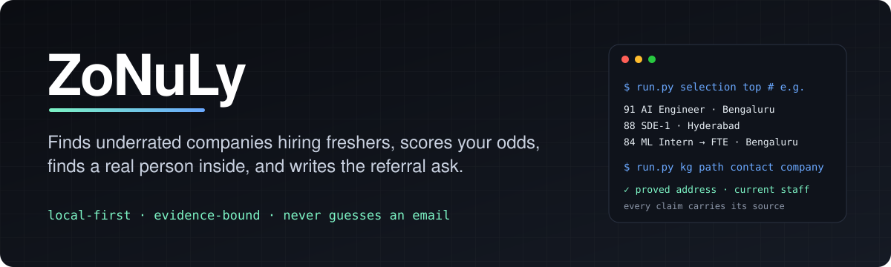
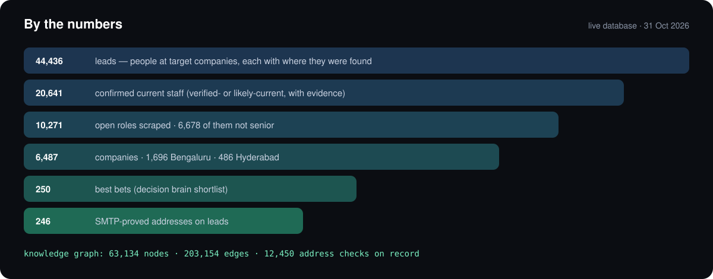
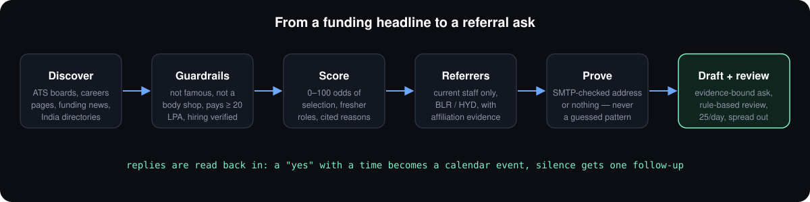
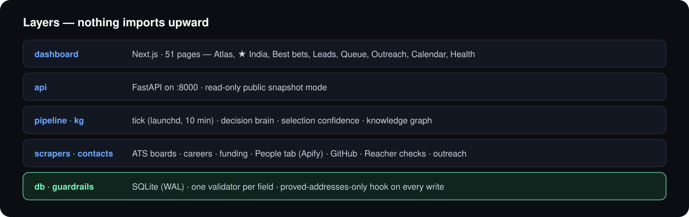

<p align="center">
  
</p>

<p align="center">
  
  
  
  
  
  
  <a href="https://github.com/Tejmul/Zonuly/actions"></a>
</p>

<p align="center">
  <b>Applying through a careers page puts you in a pile of thousands. A referral from someone who works there skips the pile.</b><br>
  ZoNuLy automates everything up to that conversation — which companies are worth your time, which roles you can actually get,
  who to ask, and what to say — with every claim traceable to a source.
</p>

---

## Contents

- [By the numbers](#by-the-numbers)
- [How it works](#how-it-works)
- [What makes it different](#what-makes-it-different)
- [Guarantees that are never traded away](#guarantees-that-are-never-traded-away)
- [The dashboard](#the-dashboard)
- [Architecture](#architecture)
- [Getting started](#getting-started)
- [Everyday commands](#everyday-commands)
- [The knowledge graph](#the-knowledge-graph)
- [Configuration](#configuration)
- [Project layout](#project-layout)
- [Public demo](#public-demo)
- [Roadmap](#roadmap)

---

## By the numbers

<p align="center">
  
</p>

| | Count | What it means |
|---|---:|---|
| **Leads** | **44,436** | People at target companies, each stored with where and how they were found |
| Confirmed current staff | 20,641 | Verified- or likely-current, with the evidence (profile, team page, org membership, live mailbox) |
| Companies | 6,487 | 1,696 in **Bengaluru** · 486 in **Hyderabad** · the rest remote / abroad |
| Open roles | 10,271 | 6,678 of them not senior — the fresher roles are what ZoNuLy hunts |
| Best bets | 250 | The decision brain's shortlist: Bengaluru first, then Hyderabad |
| **Proved addresses** | **246** | SMTP-proved, delivered-to, or vendor SMTP-verified — the only addresses a mail may go to |
| Address checks on record | 12,450 | Every verdict from [check-if-email-exists](https://github.com/reacherhq/check-if-email-exists), cached |
| Knowledge graph | 63,134 nodes · 203,154 edges | Every table mirrored, plus the project's decisions and history |
| Interview reports | 49 | Glassdoor, Reddit and blog write-ups turned into prep on the company page |
| Codebase | ~51k lines of Python · 51 dashboard pages · 29 test files | |

> Counts are read from the live database on 31 Oct 2026. The gap between *leads* and *proved addresses* is deliberate:
> an address is only used once something proves it works — see [what makes it different](#what-makes-it-different).

---

## How it works

<p align="center">
  
</p>

| Stage | What happens |
|---|---|
| **Discover** | Funded, *underrated* startups and their open roles: ATS boards (Greenhouse, Lever, Ashby, Keka, Darwinbox, Zoho Recruit, Workable …), company careers pages, funding news, public LinkedIn job postings, India startup directories. |
| **Admission + guardrails** | One gate for every company: a real name, not a duplicate, not famous or overrated (big tech, unicorns, listed, raised ≥ $1B or valued ≥ $5B), not a staffing agency or body shop, pays a fresher at least ₹20 LPA, right city. Every extracted field passes its own validator before it is written; a refused value is logged with its reason. |
| **Selection confidence** | Each role gets a 0–100 chance of selection with a band and an itemised, sourced breakdown. Two weight profiles — **India** (Bengaluru / Hyderabad, fresher eligibility, pay floor) and **Remote** — and hard blockers (visa, 3+ years, senior titles). |
| **Decision brain** | Ranks companies into shortlists — the *best bets* — by P(offer), pay power and hiring proof. |
| **Referrers** | People who work there *now*: the company's People tab (Apify, in the company's own city), GitHub org members and recent committers, team pages, talks, podcasts, bylines. A person counts only with evidence of current affiliation. |
| **Prove the address** | Every address is checked with [check-if-email-exists](https://github.com/reacherhq/check-if-email-exists) or must come from a vendor SMTP check (valid, deliverable, not catch-all). Unproved addresses are kept, never shown, never mailed. |
| **Needs brief + draft** | Reads the JD, the company's site and what their latest round is for, maps each need to the resume line that covers it, and writes a short, personal referral ask in the candidate's own voice. |
| **Review + send** | A rule-based review gate approves or rejects every draft with its reason. Sending is capped at 25 a day, spread through the day, one ask per company. |
| **Track** | Reads replies, bounces and opt-outs; classifies sentiment; turns "how about Friday 4pm?" into a calendar event; one threaded follow-up after silence. |
| **Interview prep** | Scrapes candidate reports (Glassdoor, Reddit, blogs) for a company and turns them into prep points that name the reports behind them. |

---

## What makes it different

**It never guesses an email address.** Most outreach tools fill `first.last@company.com` and hope. Guessed addresses
bounce, and bounces get the sender's inbox blocked — this project learned that the hard way. So:

- Pattern filling is switched off everywhere.
- A database hook (`db._only_verified_addresses`) refuses to put any address on a lead unless a proof row says it is safe.
- An address found on a page or a commit is kept as *unverified* — useful evidence, never mailed.
- DNS lookups that time out are treated as *unknown*, never as "no mail server".

**Evidence over vibes.** Every number on every page traces to a sentence someone wrote: the pay figure, the funding round,
the reason a person is believed to work there, the reason a role scored 84.

**Focus.** The pipeline works where the candidate wants to work. Right now that is **Bengaluru and Hyderabad**
(`focus.cities` in `config.yaml`): the people step, Apify credit and every fill queue go there first; remote waits its turn.

**Budget-aware.** Paid sources (Apify) run behind a ledger, a 24-hour cache, a daily pace and a hard monthly stop read from
the provider's own usage before every purchase.

---

## Guarantees that are never traded away

| | |
|---|---|
| 🛡️ **Proved addresses only** | No mail to a guessed or unproved address, ever. |
| ✋ **A review gate** | Every cold draft is approved or rejected by rules, with the reason logged. |
| 📉 **Send caps** | 25 a day, spread through the day — never a burst. |
| 🔎 **Confidence labels** | Every lead and number says how sure it is and why. |
| 🔒 **No personal accounts for scraping** | Public guest pages and separate tokens only. |
| ♻️ **Nothing is deleted** | Junk is quarantined, duplicates merged, both undoable. |

---

## The dashboard

A black-and-white Next.js dashboard (light and dark) over the FastAPI backend:

| Page | |
|---|---|
| **Overview** | Pipeline counts and what moved today |
| **★ India** | Every guardrail-passing Bengaluru and Hyderabad company, hand-picked rows first |
| **Atlas** | Filters (field, location, round, funded within) and a ranked, explainable network of why each company scored |
| **Best bets** | The decision brain's shortlists, India and Remote |
| **Company page** | Hiring proof, the best role, leads to reach, warm paths, pay power, **interview prep** |
| **Leads** | The referrers, with their affiliation evidence |
| **Queue / Outreach** | Drafts and their review verdicts, the send pipeline, every thread with its reply sentiment |
| **Calendar** | Calls, assessments and interviews read out of replies |
| **Health** | Hourly audit: fill rates, rejects by reason, channel health, stall alerts |

---

## Architecture

<p align="center">
  
</p>

- **Backend:** Python 3.12, FastAPI, SQLModel on SQLite (WAL), httpx
- **Frontend:** Next.js, React, Tailwind, GSAP
- **Models:** OpenRouter aliases behind a spend ledger and daily caps — no local model runtime
- **Research channels:** Jina Reader, Exa (hosted MCP via mcporter), GitHub API, yt-dlp — installed with [Agent Reach](https://github.com/Panniantong/Agent-Reach)
- **Paid data:** Apify (People tab, lead databases, job boards) behind a ledger, cache and monthly stop
- **Address proof:** [check-if-email-exists](https://github.com/reacherhq/check-if-email-exists) (Reacher CLI), SOCKS5-ready
- **Mail:** Gmail and Zoho over SMTP / IMAP
- **Scheduling:** macOS launchd — a 10-minute tick, a paced send agent, an hourly audit
- **Knowledge graph:** every table mirrored into a graph with full-text search (NetworkX)

---

## Getting started

```bash
# backend
uv sync                                   # or: python -m venv .venv && pip install -e .
cp .env.example .env                      # OPENROUTER_API_KEY, APIFY_TOKEN, mail app passwords …
python scripts/run.py doctor              # check models, budget, mail, tokens
python scripts/run.py profile             # parse your resume (profile/resume.pdf) into profile.json
python scripts/run.py serve               # API on :8000

# dashboard
cd dashboard && npm install && npm run dev   # http://localhost:3000

# run it on a schedule (macOS)
python scripts/run.py tick install        # 10-minute tick, send agent, hourly audit
```

---

## Everyday commands

```bash
python scripts/run.py selection top                  # best roles by selection confidence
python scripts/run.py research company "Acme AI"     # evidence-linked company research
python scripts/run.py outreach preflight             # launch checklist, red / amber / green with the fix
python scripts/run.py kg search "warmth"             # search the project knowledge graph

python scripts/verified_sprint.py --dry-run          # the ranked Bengaluru / Hyderabad targets and the spend
python scripts/export_referrals_csv.py               # the mail-merge CSV: proved addresses only, nothing already sent
python scripts/email_audit.py                        # real / guessed / duplicate audit of every address
python scripts/email_audit_reacher.py                # prove addresses with check-if-email-exists
```

---

## The knowledge graph

The database carries a graph of everything — every company, role, person and email, plus the project's own decisions,
gaps and session history — so any question has a path to its evidence.

```bash
python scripts/run.py kg build                       # reload context + sync data + BRIEF.md + viewer
python scripts/run.py kg show feature:warmth-tiers   # a node and everything it links to
python scripts/run.py kg path contact:3 company:12   # how two things connect
python scripts/run.py kg hubs                        # the most load-bearing nodes
```

Open `knowledge/graph.html` for the visual; `knowledge/BRIEF.md` is the generated project brief.

---

## Configuration

Everything tunable lives in [`config.yaml`](config.yaml): the focus cities, targeting (famous names, funding and valuation
ceilings, the ₹20 LPA floor), selection weights per market, the decision brain's pools, send caps, tick budgets, Apify
pace and monthly stop, model aliases. Secrets live only in `.env`.

---

## Project layout

```
jobhunter/
  scrapers/      ATS boards, careers pages, funding feeds, India job postings
  contacts/      referrer discovery, affiliation evidence, address proof (reacher.py)
  actors/        Apify sources: People tab, lead databases, job boards — budgeted and cached
  research/      search, page reading, GitHub, YouTube
  outreach/      drafting, the review gate, sending, tracking, follow-ups
  admission.py   the one gate every company passes
  guardrails.py  one validator per field, called by every write path
  interviews.py  interview reports and prep for the company page
  tick.py        the scheduled run: leads first, companies after
  api.py         FastAPI
dashboard/       Next.js dashboard
scripts/         CLI (run.py), sprint, CSV export, audits, snapshot builder, smoke test
knowledge/       knowledge graph context and the generated brief
docs/assets/     the pictures in this README
tests/           pytest
```

---

## Public demo

The public instance serves a snapshot, never the live database: `scripts/make_demo_db.py` empties the private tables
(inbound mail, address checks, model spend, cached pages), masks addresses, and stamps the snapshot with its commit and
schema. CI rebuilds the environment from the lockfile and runs `scripts/smoke.py` against it on every push.

```bash
python scripts/make_demo_db.py            # -> demo.db.gz
python scripts/smoke.py --db demo.db
```

---

## Roadmap

- [x] Proved-addresses-only, enforced in the database
- [x] Bengaluru + Hyderabad focus across every queue
- [x] Interview prep on the company page
- [x] Budgeted Apify sprint for verified referrers at the best bets
- [ ] Address proof from a port-25 server, so Gmail / Google Workspace / Microsoft addresses can be checked
- [ ] Remote companies, after Bengaluru and Hyderabad are complete
- [ ] Sending, restarted on proved addresses only, 25 a day across warmed-up inboxes

---

<p align="center">Built by <b>Tejmul Movin</b> · local-first, evidence-bound, and allergic to guessed emails.</p>
