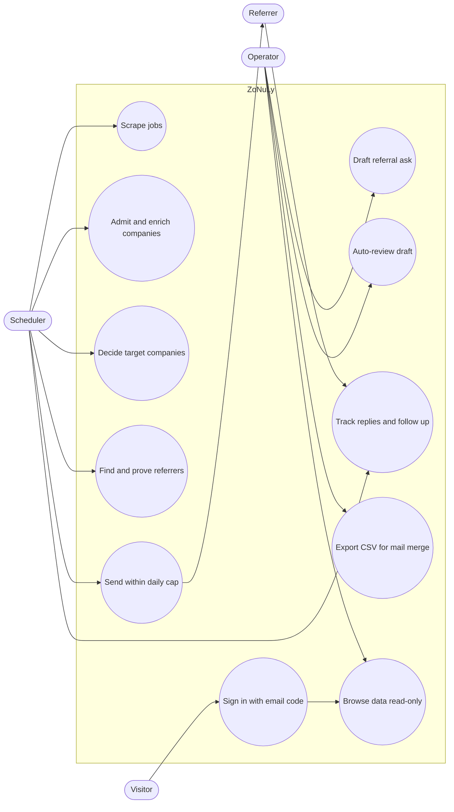
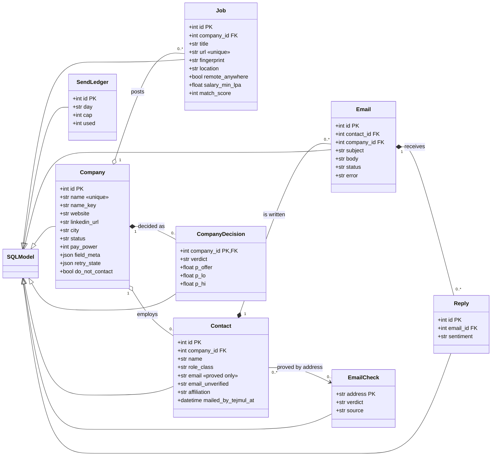
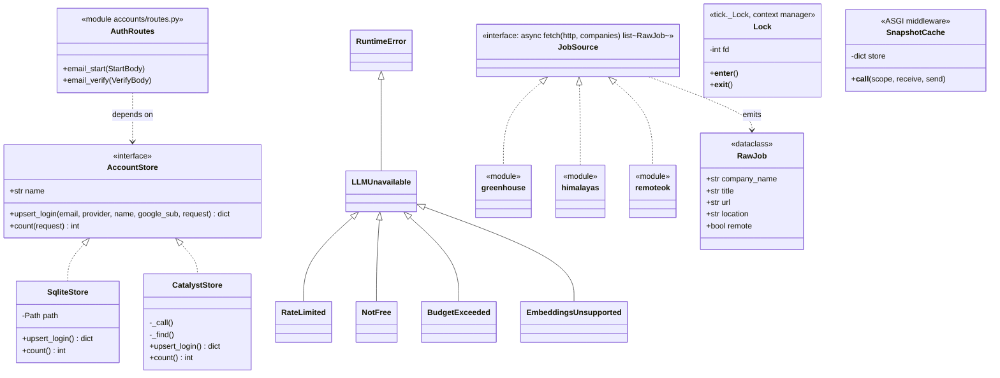
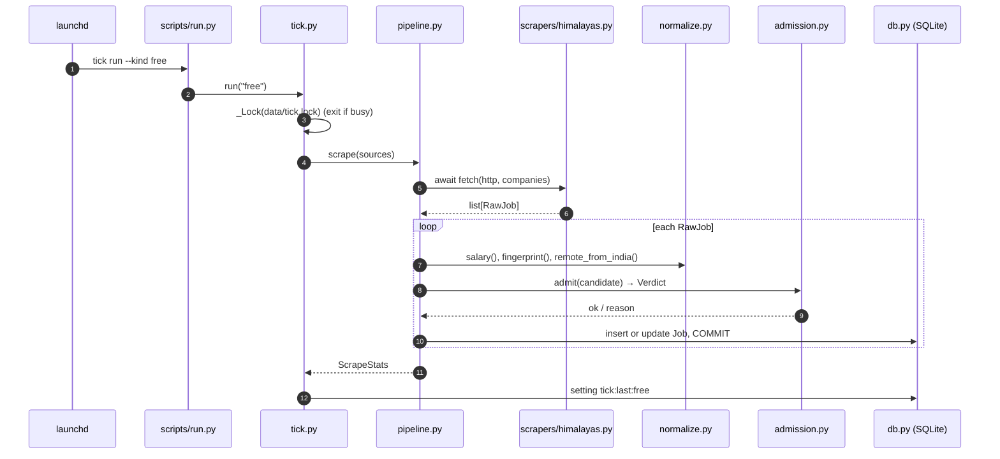
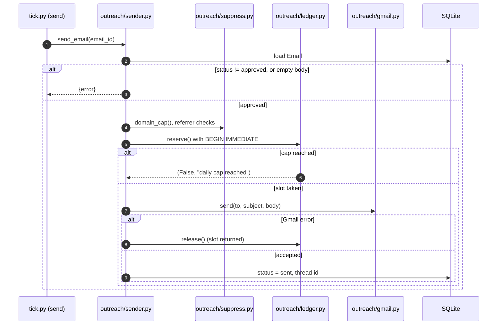
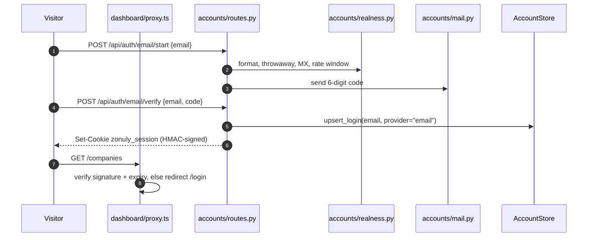
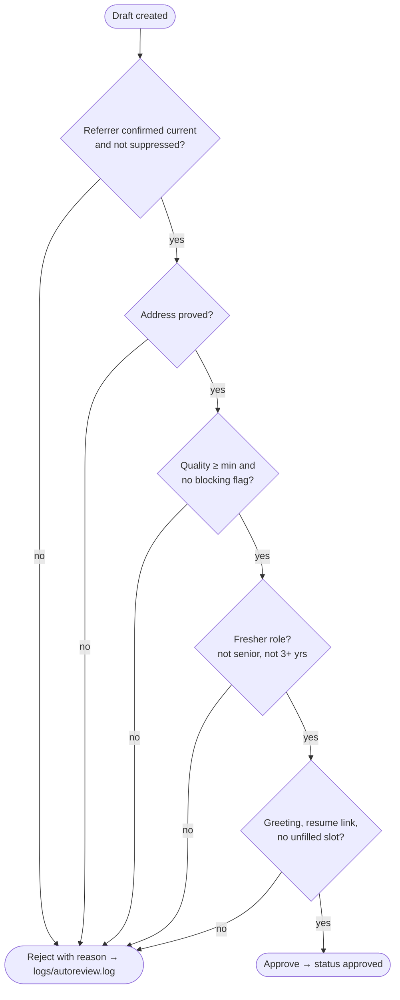
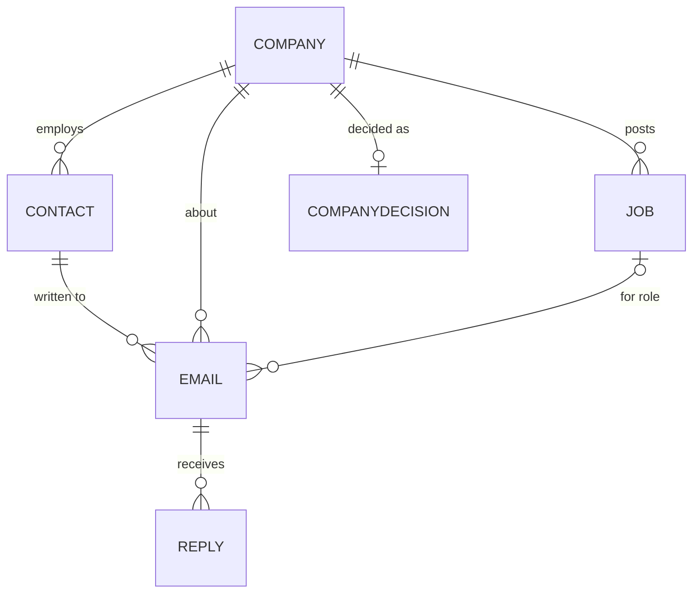

# ZoNuLy: Capstone Low-Level Design

How ZoNuLy meets each of the ten evaluation criteria for the capstone (System Design, LLD). Every claim points to a real file in this repository. Diagrams are Mermaid and render on GitHub.

| # | Criterion | Section |
|---|---|---|
| 1 | Requirement analysis: functional and non-functional requirements, use cases, actors | [§1](#1-requirement-analysis) |
| 2 | Class diagram: entities, attributes, methods, relationships, multiplicities | [§2](#2-class-diagram) |
| 3 | Object-oriented design: abstraction, encapsulation, inheritance, polymorphism, interfaces | [§3](#3-object-oriented-design) |
| 4 | SOLID principles, and where each is applied | [§4](#4-solid-principles) |
| 5 | Design patterns, with the reason for each | [§5](#5-design-patterns) |
| 6 | Sequence and activity diagrams for the core use cases | [§6](#6-sequence-and-activity-diagrams) |
| 7 | API and interface design: signatures, request/response, layers | [§7](#7-api-and-interface-design) |
| 8 | Database schema: tables, keys, relationships, indexes | [§8](#8-database-schema) |
| 9 | Error handling, validation, edge cases, concurrency | [§9](#9-error-handling-validation-and-edge-cases) |
| 10 | Working implementation: modular, demonstrable end to end | [§10](#10-working-implementation) |

**Size of the codebase (tracked files):** 306 code files and 89,534 lines of code. That is 149 Python files (54,340 lines) in `jobhunter/`, 16 scripts (5,415 lines), 33 test files (6,561 lines), and 108 dashboard TypeScript/CSS files (23,218 lines). There are about 630 test cases.

---

## 1. Requirement analysis

### Actors
| Actor | Type | What they do |
|---|---|---|
| **Operator** (the two students) | primary, human | configure targets, read leads, export CSVs, send referral asks |
| **Visitor** | primary, human | signs in with an email code and reads the public, read-only copy |
| **Scheduler** (macOS `launchd`) | primary, system | wakes the eight bounded jobs (`jobhunter/tick.py`) |
| **Referrer** | secondary, human | an engineer at a company who receives the ask and may reply |
| **External services** | secondary, system | job boards (Greenhouse, Lever, Ashby, Himalayas…), OpenRouter (LLMs), Apify, Gmail API, Zoho Catalyst, Vercel |

### Use cases


### Functional requirements
1. **FR1** Scrape job postings from about 20 sources and store each role once (dedup by URL and fingerprint).
2. **FR2** Admit a company only through one gate (real name, real website, not a duplicate, not a staffing agency).
3. **FR3** Qualify companies: pay (≥ ₹20 LPA in India, ≈ $50k/yr remote), fresher-level role, software only, remote from India first.
4. **FR4** Rank companies by the probability of an offer, or abstain when evidence is thin.
5. **FR5** Find people at each company, classify their role, confirm they still work there.
6. **FR6** Store an email address only when it is proved real.
7. **FR7** Draft one honest referral ask per person; review it by rules; send at most 25 a day.
8. **FR8** Read replies, suppress opt-outs and bounces, send at most one follow-up, put meetings on a calendar.
9. **FR9** Export CSV hand-offs that never repeat an address already written to.
10. **FR10** Serve a read-only copy behind email sign-in.

### Non-functional requirements
| NFR | Target | How it is met |
|---|---|---|
| Cost | ≈ ₹0 recurring | free sources first; paid calls behind budget gates and ledgers |
| Footprint | runs on an 8 GB laptop | SQLite, short jobs that exit, no local model |
| Reliability | survive sleep, crashes, flaky APIs | per-item commits, file locks, backoff, fallback chains |
| Safety | never mail a guessed address; ≤ 25 sends/day | database write hook; locked send ledger |
| Security | public copy cannot write or leak private mail | read-only mode, access middleware, stripped snapshot |
| Explainability | every decision has evidence | each field stores value, quote, source URL, time |
| Maintainability | change policy without code changes | `config.yaml`, layered modules, tests |

---

## 2. Class diagram

ZoNuLy is written in Python. Data entities are SQLModel classes (`jobhunter/db.py`). Services are mostly Python modules of functions, shown below as «module» with their key operations. Interfaces are `typing.Protocol` or a shared function signature.



**Relationship choices.**
- **Aggregation `o--`** Company–Job and Company–Contact. A job or person row survives a company being merged into its duplicate (`status = merged`).
- **Composition `*--`** An Email exists only for its Contact, a Reply only for its Email, and a CompanyDecision only for its Company.
- **Association `-->`** Contact → EmailCheck is linked by address. One proof covers the address wherever it appears.



---

## 3. Object-oriented design

| Concept | Where | What it does |
|---|---|---|
| **Abstraction** | `jobhunter/llm.py` | Callers ask for a role (`complete(..., alias="judge")`). They never see the provider, model id, retries or cost. |
| | `accounts/store.AccountStore` | The sign-in code sees two methods, not SQLite or the Catalyst REST API. |
| **Encapsulation** | `tick._Lock` | Holds the file descriptor and lock state privately; callers only write `with _Lock(...)`. |
| | `actors/core.Fetcher` | Keeps its cache, counters and circuit state private (`_cache_path`, `_cached`, `trip`). |
| | `accounts/realness.Window` | A rate-limit window whose counts can only change through `allow()` and `clear()`. |
| | Private names | A leading underscore (`_store`, `_conn`, `_row`) marks module-private state. |
| **Inheritance** | `db.py` | 26 entity classes inherit `SQLModel`, which gives them ORM mapping and validation. |
| | `openrouter.py` | `LLMUnavailable(RuntimeError)` → `RateLimited`, `NotFree`, `BudgetExceeded`, `_ModelGone`; `llm.EmbeddingsUnsupported`. |
| | `api.py` | 19 request bodies inherit Pydantic `BaseModel`. |
| **Polymorphism** | `AccountStore` | `get_store().upsert_login(...)` runs SqliteStore's or CatalystStore's code depending on the object. |
| | Scrapers | `pipeline.scrape` calls `fetch(http, companies)` on any of 20 sources, each implemented differently. |
| | Exceptions | `except LLMUnavailable:` handles every subclass the same way: the stage degrades and does not crash. |
| **Interfaces / abstract types** | `AccountStore(Protocol)` | An explicit interface, checkable at runtime (`@runtime_checkable`). |
| | `JobSource` | The shared scraper signature `async fetch(http, companies) -> list[RawJob]` (`scrapers/__init__.py`). |

**Why mostly modules, not deep class trees?** Python treats modules as first-class units, so a stage is a module with one public function. Inheritance is used only where it carries real behaviour (ORM base, exception families, request validation), and composition is preferred everywhere else.

---

## 4. SOLID principles

| Principle | Where it is applied | Evidence |
|---|---|---|
| **S: Single Responsibility** | Each module does one job | `admission.py` only admits companies; `outreach/ledger.py` only owns the daily cap (`reserve`, `release`); `fit.py` only scores word overlap; each scraper reads one source |
| **O: Open/Closed** | Extend without editing existing code | A new job source is a new module, one `REGISTRY` line in `scrapers/__init__.py` and one `config.yaml` flag; `pipeline.py` is unchanged. A new model is a config line. A new account backend implements `AccountStore`. |
| **L: Liskov Substitution** | Subtypes are drop-in | `SqliteStore` and `CatalystStore` are interchangeable behind `get_store()`. Any `LLMUnavailable` subclass can be raised where callers expect `LLMUnavailable`. |
| **I: Interface Segregation** | Small interfaces | `AccountStore` has two methods. A scraper needs only `fetch`. Each endpoint has its own small request model (`ApproveIn`, `DraftIn`, `StartBody`) instead of one large DTO. |
| **D: Dependency Inversion** | High-level code depends on abstractions | Pipeline stages depend on `llm.complete(alias)`, not on OpenRouter. `accounts/routes.py` depends on `AccountStore`, not on a concrete store. Scrapers receive their HTTP client as a parameter (dependency injection). |

---

## 5. Design patterns

| Pattern | Type | Where | Why it was chosen |
|---|---|---|---|
| **Singleton** | creational | `jobhunter/__init__.CONFIG`, `db.engine`, `accounts/store.get_store()` (lazy, thread-safe with a lock) | One config, one connection pool, one account store per process; creating them twice would waste resources or diverge |
| **Factory** | creational | `accounts/store.get_store()` picks the store from `ZONULY_ACCOUNTS`; `scrapers.get_fetcher(name)` resolves a source by name; `scrapers/base.make_client()` | Callers ask for "a store" or "the himalayas source" without knowing the class or import path |
| **Strategy** | behavioural | `AccountStore` implementations; one scraper per source; `confidence.py` uses an India weight profile vs a remote weight profile | Swap algorithms by configuration, not by editing callers |
| **Observer** | behavioural | SQLAlchemy listeners: `@event.listens_for(Session, "before_flush")` guards every write; `@event.listens_for(engine, "connect")` sets SQLite pragmas | The address rule runs on every save from every code path, including code written later |
| **Chain of Responsibility** | behavioural | `openrouter.complete` walks an alias's ranked model chain until one answers; `outreach/gates.py` and `autoreview.py` pass a draft through a chain of checks, any of which can reject | Free models disappear; a draft must pass every rule |
| **State** | behavioural | `Email.status`: `draft → approved → sending → sent → replied / failed`, plus `rejected` | Only an `approved` email may be sent (`sender.send_email` checks) |
| **Decorator** | structural | ASGI middleware `SnapshotCache` and the access middleware wrap the app; FastAPI `@app.get` route decorators; `@dataclass` | Adds caching and access control around every route without touching handlers |
| **Adapter** | structural | `llm.py` adapts OpenRouter to the old function signatures; `actors/apify_source.py` turns vendor records into the person shape; `scrapers/himalayas.to_raw` turns board JSON into `RawJob` | Keeps vendor formats at the edge |
| **Facade** | structural | `llm.py` (one entry for every model call); `tick.py` (one entry per scheduled job) | Hides many subsystems behind one simple call |
| **Proxy** | structural | `dashboard/proxy.ts` checks the session before a page renders; Vercel `/zapi/*` rewrites to the API | Access control and caching in front of the real service |
| **Repository** | architectural | `accounts/store.py`, `kg/store.Graph` (`upsert_node`, `upsert_edge`) | Storage details behind a collection-like interface |
| **Builder** | creational | *Not used.* No object here is assembled in many optional steps; dataclasses with defaults cover it | Adding one would be ceremony without benefit |

---

## 6. Sequence and activity diagrams

### 6.1 Scheduled scrape (core use case: FR1, FR2)


### 6.2 Send one approved email (FR7)


### 6.3 Sign in (FR10)


### 6.4 Activity: auto-review of a draft (FR7)


---

## 7. API and interface design

**Layers.**
- **Controller:** `jobhunter/api.py`, `accounts/routes.py`, `outreach/routes.py`, `research/routes.py`. These are FastAPI handlers that validate input and map errors to HTTP codes.
- **Service:** modules such as `outreach/sender.py`, `decide.py`, `pipeline.py`, `referrals.py`. They hold the business rules.
- **Repository / data:** `db.py` (SQLModel sessions, write hooks), `accounts/store.py`, `kg/store.py`.

For actions that change state (draft, approve, send, add a company), controllers call a service and never write SQL themselves. Simple read-only lists query the database directly in the handler. Long work (scrape, score) returns a `task_id` that the dashboard polls (`/api/tasks/{id}`).

| Method | Path | Request | Response | Service called |
|---|---|---|---|---|
| GET | `/api/health` | – | `{ok, public, snapshot, auth_required}` | `access.status`, `snapshot` |
| GET | `/api/companies` | `?tier=&hiring=&sort=` | `[Company + counts]` | read query in the handler (a read-only path) |
| POST | `/api/companies` | `NewCompany {name, website?, …}` | `{task_id}`, then poll `/api/tasks/{id}` | `onboard.add_company` → `admission.admit` |
| GET | `/api/emails` | `?status=` | `[Email]` | db query |
| POST | `/api/emails/draft` | `DraftIn {contact_id, job_id?}` | `{email_id, subject, body}` | `outreach/drafter` |
| POST | `/api/emails/{id}/approve` | `ApproveIn {subject?, body?}` | `{ok}` or 400 | `sender.approve` |
| POST | `/api/emails/{id}/send` | `?ignore_window=false` | `{sent, thread_id}` or 400 | `sender.send_email` |
| POST | `/api/auth/email/start` | `StartBody {email}` | `{ok}` or 400/429 | `realness`, `mail` |
| POST | `/api/auth/email/verify` | `VerifyBody {email, code}` | `{user}` + cookie | `tokens`, `AccountStore` |
| GET | `/api/kg/search` | `?q=` | nodes | `kg` |

There are 113 routes in all, grouped as companies (16), emails (11), outreach (10), kg (10), decide (7), pipeline (6), gmail (6) and others.

**Interface signatures (Python).**
```python
async def fetch(http: httpx.AsyncClient, companies: list[dict] | None = None) -> list[RawJob]     # every scraper
def admit(candidate: Candidate, session: Session) -> Verdict                                      # admission.py
def remote_from_india(location: str | None, description: str | None = None) -> bool               # normalize.py
def reserve(candidate_id: int = 1, *, guessed: bool = False) -> tuple[bool, str]                  # outreach/ledger.py
def send_email(email_id: int, *, ignore_window: bool = False, inbox: str | None = None) -> dict   # outreach/sender.py
def get_store() -> AccountStore                                                                   # accounts/store.py
```

---

## 8. Database schema

SQLite file `jobhunter.db`, mapped from the classes in `jobhunter/db.py` (SQLModel generates the DDL).

| Table | Primary key | Foreign keys | Unique | Indexed columns (why) |
|---|---|---|---|---|
| `company` | `id` | – | `name` | `name_key` (dedup), `status`, `tier`, `pay_power`, `priority_score`, `do_not_contact`, `filled_at` (queue order and filters) |
| `job` | `id` | `company_id → company.id` | `url` | `fingerprint` (cross-source dedup), `remote_anywhere`, `is_senior`, `status`, `selection_score` |
| `contact` | `id` | `company_id → company.id` | – | `email`, `email_unverified`, `email_status`, `affiliation`, `role_class`, `referral_rank`, `do_not_contact` |
| `email` | `id` | `contact_id → contact.id`, `company_id → company.id`, `job_id → job.id` | – | `status` (the send queue) |
| `reply` | `id` | `email_id → email.id` | `gmail_message_id` (no duplicate import) | `sentiment` |
| `emailcheck` | `address` | – | – | `verdict` |
| `companydecision` | `company_id` (also FK) | `company_id → company.id` | – | `pool`, `verdict`, `p_offer` |
| `sendledger` | `id` | – | – | `day`, `candidate_id` |

Other tables:
- **Audit:** `extraction_reject`, `extraction_write`, `llm_call`
- **Operations:** `setting`, `channel_hour`, `event`
- **CSV hand-offs:** `csv_batch`, `csv_batch_contact`
- **Knowledge graph:** `kg_node`, `kg_edge`, `kg_fts` (an FTS5 full-text index)



**Journal mode:** the database runs in WAL mode (`db._sqlite_pragmas`). Readers never block the writer, so the dashboard and the scheduled jobs don't lock each other out.

---

## 9. Error handling, validation and edge cases

**Validation.**
- **Request bodies:** Pydantic models reject malformed input with **422** before any handler runs.
- **Extracted data:** every scraped field passes `guardrails.py`, which stores value, evidence quote, source, time and confidence. A rejected value is logged to `extraction_reject` with its reason.
- **New companies:** pass `admission.admit()`, which returns a `Verdict` (`ok`, `reason`). Junk names, duplicates and staffing agencies are refused.
- **Email addresses:** checked inside `db._only_verified_addresses` and `_no_guessed_addresses` (the `before_flush` hook). An unproved or constructed address cannot be saved, whatever code tried.

**Failures.**

| Failure | Behaviour |
|---|---|
| A job source is down or changes shape | Fault-isolated per source; the run continues; the hourly `audit.py` reports the drop |
| A company's site keeps failing | `backoff.py` records it and retries after 1, 3, 7, 21, then 60 days |
| An LLM model is gone or rate-limited | `RateLimited` or `_ModelGone`, then the next model in the chain; if all fail, `LLMUnavailable` and the stage is skipped |
| Paid call over budget | `BudgetExceeded`; the Apify pre-flight estimate refuses before spending |
| Gmail send fails after the slot is taken | `ledger.release()` returns the slot |
| A job hangs and holds a lock | `watchdog.py` flags a live process past its limit with a silent log |
| Public snapshot older than the code | `/api/health` reports a schema-stamp mismatch; CI smoke tests fail the deploy |

**HTTP errors.**

| Code | Meaning |
|---|---|
| 400 | Service refused, e.g. "email is draft, only approved emails are sent" |
| 401 | Not signed in |
| 403 | A write, or an operator-only route, on the public site |
| 404 | Unknown id |
| 422 | Invalid body |
| 429 | Sign-in rate limit |

**Concurrency.**
- **Daily cap race:** two senders both read 24. `ledger.reserve` runs `BEGIN IMMEDIATE`, which takes the SQLite write lock, checks `used < cap` and increments inside one transaction, so the second sender waits and then sees 25.
- **Two jobs at once:** `tick._Lock` uses a non-blocking `fcntl.flock`. The second job exits immediately, and the OS frees the lock if the process dies.
- **Crash mid-run:** every item commits on its own. Dedup keys (`job.url` unique, `fingerprint`, `company.name` unique) make a re-run idempotent.
- **Account store across threads:** `get_store()` is guarded by a `threading.Lock`.

**Edge cases handled.**
- The same role posted on three boards is stored once.
- A US-only "remote-first" posting is not counted as remote from India (20 test cases in `tests/test_remote_from_india.py`).
- An email with an empty subject or body is never sent.
- An opt-out reply suppresses the person and the company forever.
- A bounce kills the address permanently.
- A follow-up can be created only once (`followup_sent` is set when it is queued).

---

## 10. Working implementation

```bash
uv sync                                   # install (locked versions)
python scripts/run.py doctor              # check configuration and keys
python scripts/run.py scrape --sources himalayas
python scripts/run.py serve               # FastAPI on :8000
cd dashboard && npm run dev               # dashboard on :3000
.venv/bin/python -m pytest -q             # ~630 test cases
python scripts/export_referrals_csv.py --remote   # CSV hand-off (proved addresses only)
```

**End-to-end demo path.**
1. Run `scrape --sources himalayas`; new jobs appear on **Roles**.
2. Open **Companies**; a remote company shows its facts and evidence.
3. Open **Leads**; the people found, with proved addresses only.
4. Draft and approve an ask; the daily cap is visible.
5. Export the CSV.
6. The live read-only copy is at zonuly.tejmul.in (sign in with an email code).

**CI/CD.**
- `.github/workflows/snapshot.yml` smoke-tests the snapshot, builds and deploys the API to Zoho Catalyst, then smoke-tests the live API.
- Vercel deploys the dashboard on every merge to `main`.

**Individual contributions** (fill in before the evaluation):

| Area | Main files | Owner |
|---|---|---|
| Scraping and admission | `scrapers/`, `pipeline.py`, `admission.py`, `normalize.py` | |
| Decision model | `fit.py`, `matcher.py`, `decide.py`, `remote.py` | |
| People and proof | `contacts/`, `actors/`, `referrals.py` | |
| Outreach | `outreach/` | |
| API, auth and deployment | `api.py`, `access.py`, `accounts/`, `.github/workflows/` | |
| Dashboard | `dashboard/` | |
