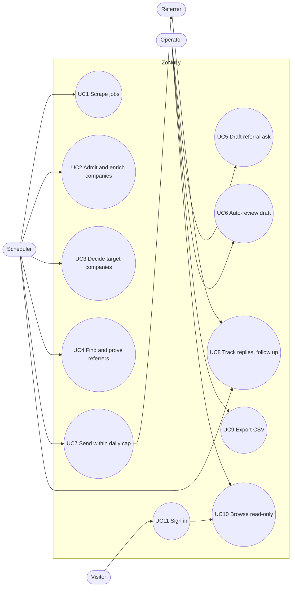

[System design](README.md) · **1 Requirements** · [2 Class diagram →](02-class-diagram.md)

# 1. Requirement analysis

## The problem
A cold job application is one of hundreds; a referral from an engineer inside the company gets read. Getting a referral by hand takes about 20 minutes per person: find the right engineer, find a working email, write something honest, send it, follow up. ZoNuLy automates that, for companies that can hire us remotely from India first and in Bengaluru / Hyderabad second.

## Actors

| Actor | Kind | Goal |
|---|---|---|
| **Operator** (the two students) | primary, human | choose targets, read leads, export CSVs, send referral asks |
| **Visitor** | primary, human | sign in with an email code and browse the read-only public copy |
| **Scheduler** (macOS `launchd`) | primary, system | start the eight bounded jobs on a timer (`jobhunter/tick.py`) |
| **Referrer** | secondary, human | an engineer who receives an ask and may reply |
| **Job sources** | secondary, system | Greenhouse, Lever, Ashby, Himalayas, WWR, RemoteOK, HN… |
| **Service providers** | secondary, system | OpenRouter (AI models), Apify (people search), Gmail API, Zoho Catalyst, Vercel |

## Use cases

| Use case | Actor | Main flow | Code |
|---|---|---|---|
| UC1 Scrape jobs | Scheduler | fetch every enabled source, store each role once | `pipeline.scrape`, `scrapers/*` |
| UC2 Admit and enrich | Scheduler | one gate creates a company; later runs fill its facts | `admission.admit`, `fill.py`, `enrich.py` |
| UC3 Decide targets | Scheduler | score fit, estimate P(offer), or abstain | `fit.py`, `matcher.py`, `decide.py`, `remote.py` |
| UC4 Find and prove referrers | Scheduler | buy People tabs within budget; keep proved emails only | `referrals.apify_queue`, `actors/apify_source.py` |
| UC5 Draft | Operator / Scheduler | fill the template with real facts | `outreach/drafter.py` |
| UC6 Auto-review | Scheduler | rules approve or reject with a reason | `outreach/autoreview.py` |
| UC7 Send | Scheduler | at most one per run, 25 a day, 10:00–19:00 | `outreach/sender.py`, `outreach/ledger.py` |
| UC8 Track replies | Scheduler | classify replies, suppress opt-outs, one follow-up | `outreach/tracker.py`, `outreach/suppress.py` |
| UC9 Export CSV | Operator | proved addresses never sent before | `scripts/export_referrals_csv.py` |
| UC10 Browse | Visitor, Operator | read companies, roles, leads, graph | `api.py`, `dashboard/` |
| UC11 Sign in | Visitor | email code, then a signed session cookie | `accounts/routes.py` |

## Functional requirements

| ID | Requirement |
|---|---|
| FR1 | Scrape job postings from about 20 sources and store each role once (dedup by URL and fingerprint). |
| FR2 | Create a company only through one admission gate: real name, real website, not a duplicate, not a staffing agency. |
| FR3 | Qualify companies: pay ≥ ₹20 LPA (India) or ≈ $50k/yr (remote), a fresher-level role, software only, remote from India first. |
| FR4 | Rank companies by the probability of an offer; abstain when the evidence is thin. |
| FR5 | Find people at each company, classify their role, confirm they still work there. |
| FR6 | Store an email address only when it is proved deliverable. |
| FR7 | Draft one honest ask per person, review it by rules, send at most 25 a day. |
| FR8 | Read replies; suppress opt-outs and bounces; at most one follow-up; meetings go on a calendar. |
| FR9 | Export CSV hand-offs that never repeat an address already written to. |
| FR10 | Serve a read-only copy behind email sign-in. |

## Non-functional requirements

| ID | Quality | Target | How it is met |
|---|---|---|---|
| NFR1 | Cost | ≈ ₹0 a month | free sources first; paid calls behind budget gates, caches and ledgers |
| NFR2 | Footprint | runs on an 8 GB laptop | SQLite, short jobs that exit, no local AI model |
| NFR3 | Reliability | survive sleep, crashes, flaky APIs | per-item commits, file locks, backoff, model fallback chains |
| NFR4 | Safety | never mail a guessed address; ≤ 25 sends a day | database write hook; locked send ledger |
| NFR5 | Security | the public copy cannot write or leak private mail | read-only mode, access middleware, stripped snapshot |
| NFR6 | Explainability | every decision has evidence | each field stores value, quote, source URL, time |
| NFR7 | Maintainability | change policy without code changes | `config.yaml`, layered modules, ~630 tests |
| NFR8 | Politeness | no account bans | per-host pacing, no logged-in scraping |

---
[System design](README.md) · [2 Class diagram →](02-class-diagram.md)
