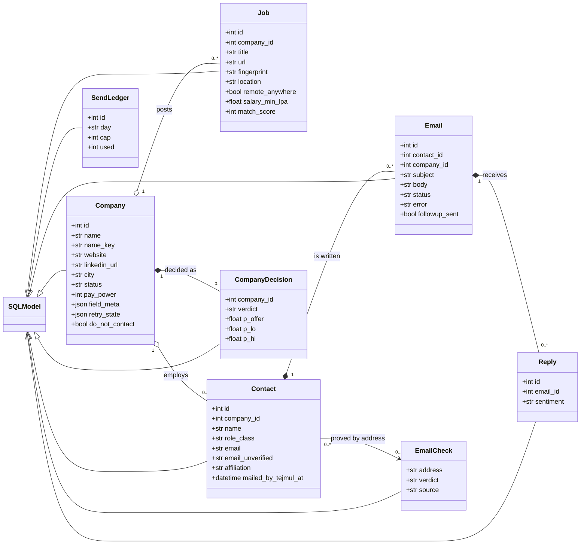
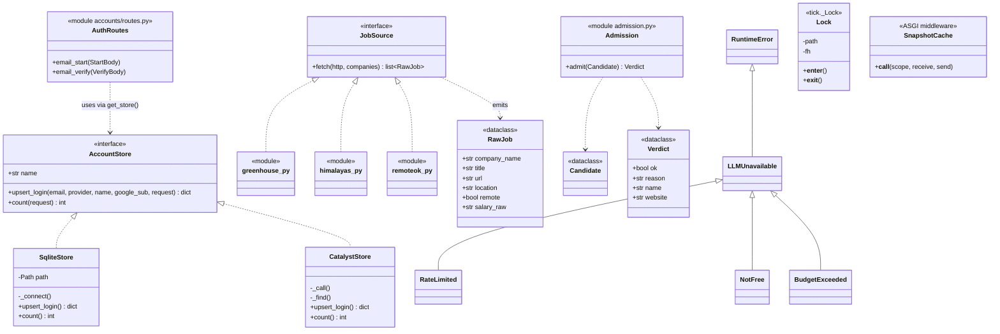

[← 1 Requirements](01-requirement-analysis.md) · [System design](README.md) · **2 Class diagram** · [3 OOP →](03-object-oriented-design.md)

# 2. Class diagram

ZoNuLy is Python. Its classes fall into four groups:
- **Entities**: SQLModel classes in `jobhunter/db.py`, each one a database table.
- **Value objects**: dataclasses passed between stages, such as `RawJob`, `Verdict` and `Target`.
- **Services and interfaces**: `AccountStore`, the scraper interface, and modules of functions, shown below as «module».
- **Errors**: an exception family.

There are 133 classes in `jobhunter/`.

## 2.1 Domain entities

### Why each relationship type
| Relationship | Type | Multiplicity | Reason |
|---|---|---|---|
| Company → Job | **aggregation** (`o--`) | 1 to 0..* | a job row survives its company being merged into a duplicate (`status = merged`) |
| Company → Contact | **aggregation** | 1 to 0..* | same: people outlive a merge |
| Company → CompanyDecision | **composition** (`*--`) | 1 to 0..1 | a decision has no meaning without its company (its primary key *is* `company_id`) |
| Contact → Email | **composition** | 1 to 0..* | an email exists only for the person it is written to |
| Email → Reply | **composition** | 1 to 0..* | a reply exists only as an answer to an email |
| Contact → EmailCheck | **association** (`-->`) | 0..* to 0..1 | linked by address; one proof covers that address wherever it appears |
| SQLModel → every table | **inheritance** (`<|--`) | – | gives ORM mapping and validation |

## 2.2 Services, interfaces, value objects and errors

| Class | File | Role |
|---|---|---|
| `AccountStore` | `accounts/store.py` | interface (Python `Protocol`) for where accounts live |
| `SqliteStore`, `CatalystStore` | `accounts/store.py` | the two implementations (laptop, deployed) |
| `RawJob` | `scrapers/base.py` | what every scraper emits |
| `Candidate`, `Verdict` | `admission.py` | input and output of the admission gate |
| `Check` | `guardrails.py` | one validator's verdict (`ok`, `value`, `reason`, `confidence`) |
| `Target` | `remote.py` | a remote-from-India company and its best role |
| `LLMUnavailable` family | `openrouter.py`, `llm.py` | typed AI-call failures |
| `_Lock` | `tick.py` | file lock as a context manager |
| `SnapshotCache` | `snapshot_cache.py` | response cache wrapped around the API |
| `Graph` | `kg/store.py` | repository for the knowledge graph (`upsert_node`, `upsert_edge`) |

---
[← 1 Requirements](01-requirement-analysis.md) · [System design](README.md) · [3 OOP →](03-object-oriented-design.md)
