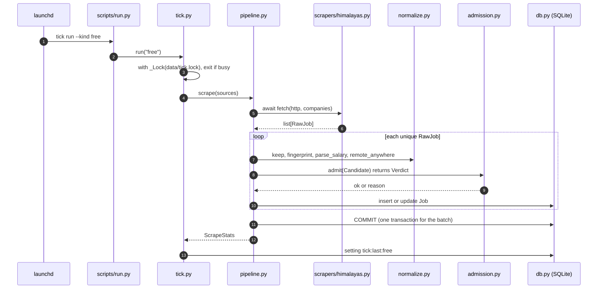
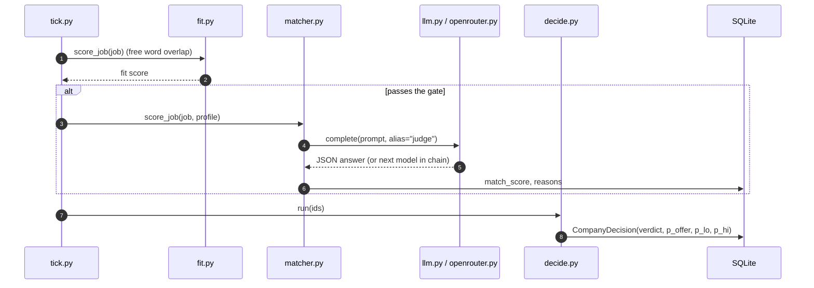
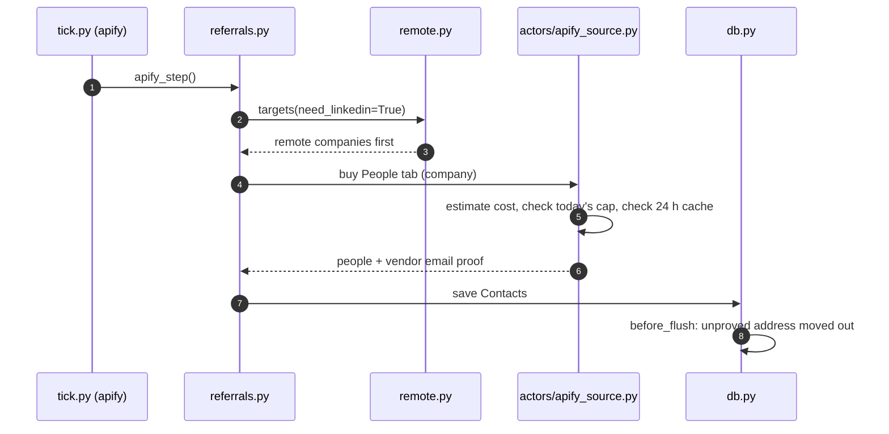
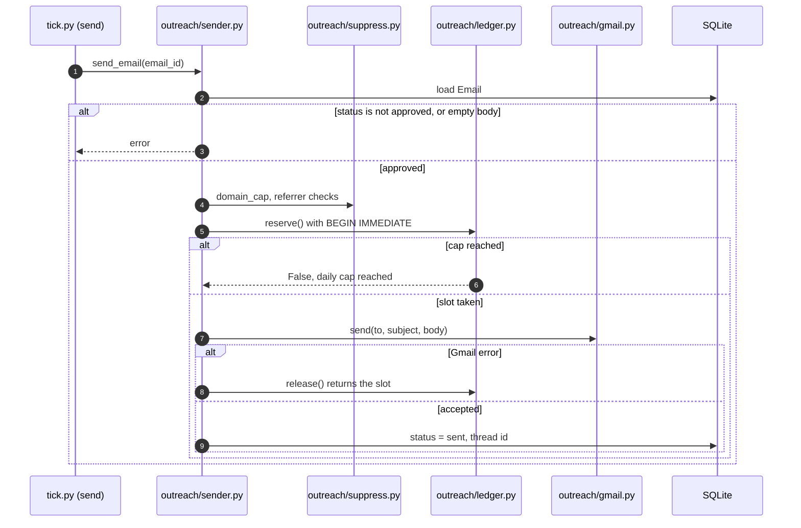
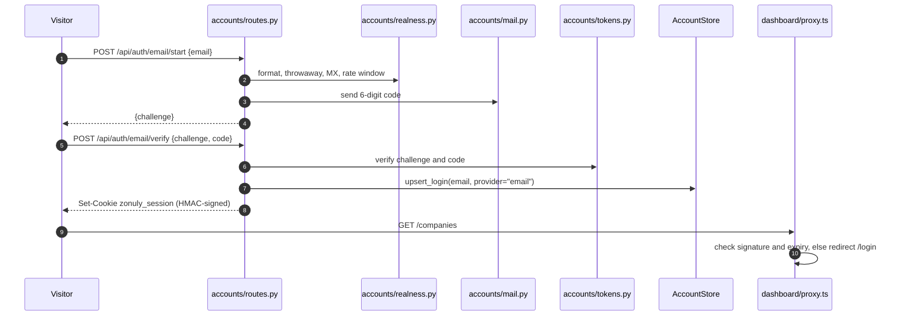
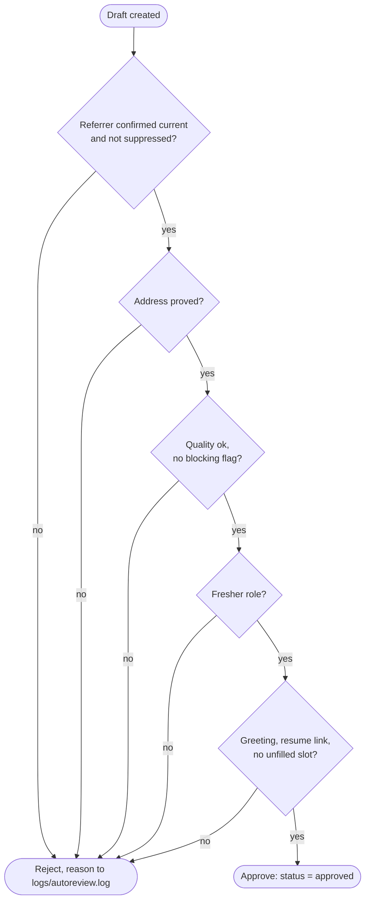
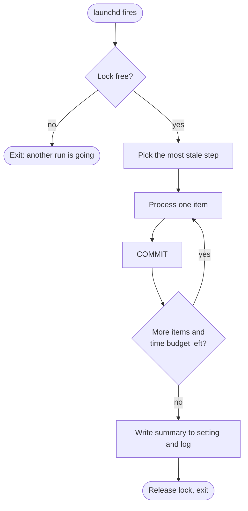
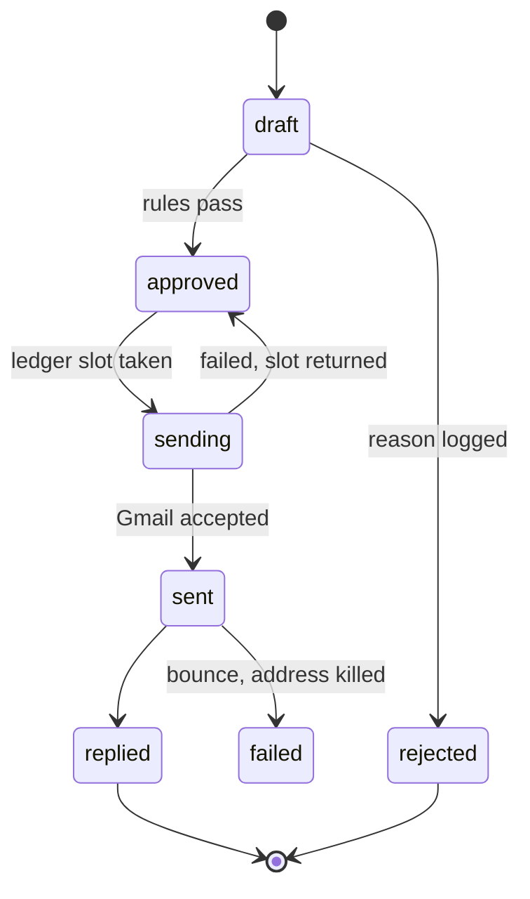

[← 5 Design patterns](05-design-patterns.md) · [System design](README.md) · **6 Diagrams** · [7 API →](07-api-and-interface-design.md)

# 6. Sequence and activity diagrams

## 6.1 Scheduled scrape (UC1, UC2)

## 6.2 Decide a company (UC3)

## 6.3 Find people and prove addresses (UC4)

## 6.4 Send one approved email (UC7)

## 6.5 Sign in (UC11)

## 6.6 Activity: auto-review a draft (UC6)

## 6.7 Activity: one scheduled job run

## 6.8 State: email lifecycle

---
[← 5 Design patterns](05-design-patterns.md) · [System design](README.md) · [7 API →](07-api-and-interface-design.md)
