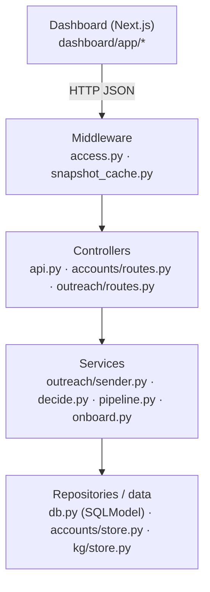

[← 6 Diagrams](06-sequence-and-activity-diagrams.md) · [System design](README.md) · **7 API** · [8 Database →](08-database-schema.md)

# 7. API and interface design

## 7.1 Layers



| Layer | Responsibility | Example |
|---|---|---|
| Middleware | cross-cutting rules for every request | `access.refusal()` → 401 / 403; `SnapshotCache` |
| Controller | validate input, call one service, map errors to HTTP | `approve_email(email_id, payload: ApproveIn)` |
| Service | business rules | `sender.approve()`, `sender.send_email()` |
| Repository | storage | `get_session()`, `get_store().upsert_login()` |

A controller from `api.py`, showing the separation:
```python
class ApproveIn(BaseModel):
    subject: str | None = None
    body: str | None = None

@app.post("/api/emails/{email_id}/approve")
def approve_email(email_id: int, payload: ApproveIn | None = None) -> dict:
    from jobhunter.outreach import sender
    payload = payload or ApproveIn()
    result = sender.approve(email_id, subject=payload.subject, body=payload.body)   # service
    if "error" in result:
        raise HTTPException(400, result["error"])                                    # error → HTTP
    return result
```
- **State-changing actions** (draft, approve, send, add a company): the controller calls a service.
- **Simple read-only lists:** the handler queries the database directly.
- **Long work** (scrape, score, add a company): returns `{task_id}` immediately, and the dashboard polls `GET /api/tasks/{id}`.

## 7.2 Endpoints (selection of the 113 routes)

| Method | Path | Request | Response | Service |
|---|---|---|---|---|
| GET | `/api/health` | – | `{ok, public, snapshot, auth_required}` | `access.status`, `snapshot` |
| GET | `/api/companies` | `?tier=&hiring=&sort=` | `[Company + counts]` | read query in the handler |
| POST | `/api/companies` | `NewCompany {name, website?, …}` | `{task_id}` | `onboard.add_company` → `admission.admit` |
| GET | `/api/emails` | `?status=` | `[Email]` | read query |
| POST | `/api/emails/draft` | `DraftIn {contact_id, job_id?}` | `{email_id, subject, body}` | `outreach/drafter` |
| POST | `/api/emails/{id}/approve` | `ApproveIn {subject?, body?}` | `{ok}` or 400 | `sender.approve` |
| POST | `/api/emails/{id}/reject` | – | `{ok}` or 400 | `sender.reject` |
| POST | `/api/emails/{id}/send` | `?ignore_window=false` | `{sent, thread_id}` or 400 | `sender.send_email` |
| POST | `/api/auth/email/start` | `StartBody {email, name?, turnstile?}` | `{challenge, email, expires_in}` or 400 / 429 | `realness`, `mail` |
| POST | `/api/auth/email/verify` | `VerifyBody {challenge, code}` | user + `Set-Cookie` | `tokens`, `AccountStore` |
| GET | `/api/auth/me` | cookie | `{user}` or `null` | `tokens` |
| GET | `/api/kg/search` | `?q=` | matching nodes | `kg` |
| GET | `/api/tasks/{id}` | – | `{status, result}` | task registry |

Routes by group: companies 16 · emails 11 · outreach 10 · kg 10 · decide 7 · pipeline 6 · gmail 6 · and smaller groups.

## 7.3 Internal interfaces (method signatures)

```python
# every scraper (scrapers/*.py)
async def fetch(http: httpx.AsyncClient, companies: list[dict] | None = None) -> list[RawJob]

# admission.py
def admit(cand: Candidate, session=None) -> Verdict

# normalize.py
def remote_from_india(location: str | None, description: str | None = None) -> bool

# openrouter.py
def complete(prompt: str, system: str | None = None, *, alias: str, ...) -> Answer

# outreach/ledger.py
def reserve(candidate_id: int = 1, *, guessed: bool = False) -> tuple[bool, str]
def release(candidate_id: int = 1, *, guessed: bool = False) -> None

# outreach/sender.py
def approve(email_id: int, *, subject: str | None = None, body: str | None = None) -> dict
def send_email(email_id: int, *, ignore_window: bool = False, inbox: str | None = None) -> dict

# accounts/store.py
def get_store() -> AccountStore
```

---
[← 6 Diagrams](06-sequence-and-activity-diagrams.md) · [System design](README.md) · [8 Database →](08-database-schema.md)
