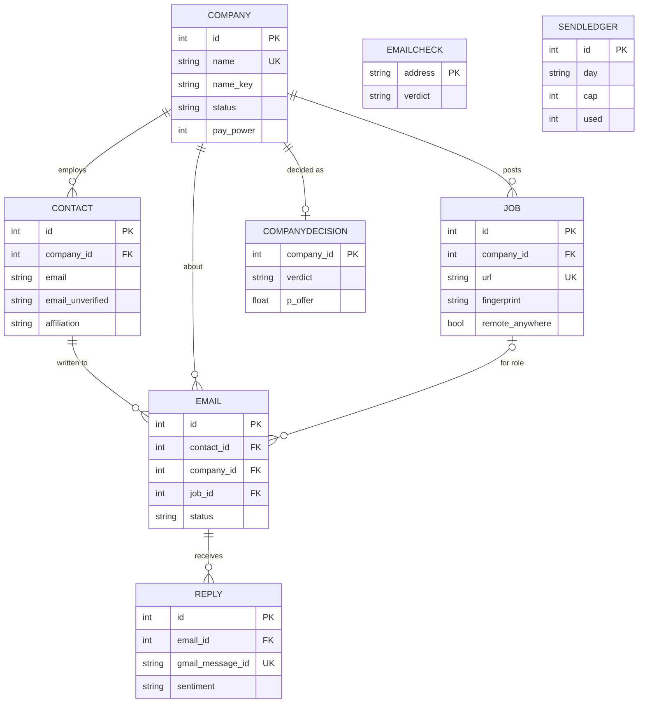

[← 7 API](07-api-and-interface-design.md) · [System design](README.md) · **8 Database** · [9 Errors →](09-error-handling-and-edge-cases.md)

# 8. Database schema

The database is one SQLite file, `jobhunter.db`. The tables are generated from the classes in `jobhunter/db.py` by SQLModel, so the class design and the schema are the same source.

## 8.1 Entity-relationship diagram

## 8.2 Tables, keys and indexes

| Table | Primary key | Foreign keys | Unique | Indexed (why) |
|---|---|---|---|---|
| `company` | `id` | – | `name` | `name_key` (dedup), `status`, `tier`, `pay_power`, `priority_score`, `do_not_contact`, `filled_at` (queue order and filters) |
| `job` | `id` | `company_id → company.id` | `url` | `fingerprint` (cross-source dedup), `remote_anywhere`, `is_senior`, `status`, `selection_score` |
| `contact` | `id` | `company_id → company.id` | – | `email`, `email_unverified`, `email_status`, `affiliation`, `role_class`, `referral_rank`, `do_not_contact` |
| `email` | `id` | `contact_id → contact.id`, `company_id → company.id`, `job_id → job.id` | – | `status` (the send queue reads it) |
| `reply` | `id` | `email_id → email.id` | `gmail_message_id` (a reply is never imported twice) | `sentiment` |
| `emailcheck` | `address` | – | – | `verdict` |
| `companydecision` | `company_id` (also the FK) | `company_id → company.id` | – | `pool`, `verdict`, `p_offer` |
| `sendledger` | `id` | – | – | `day`, `candidate_id` |

Other tables:
- **Audit trail:** `extraction_reject` (why a value was refused), `extraction_write`, `llm_call` (the cost of each AI call)
- **Operations:** `setting` (job status, key-value), `channel_hour` (rate accounting), `event` (calendar)
- **CSV hand-offs:** `csv_batch`, `csv_batch_contact`
- **Knowledge graph:** `kg_node`, `kg_edge`, `kg_fts` (an FTS5 full-text index)

## 8.3 From class design to schema
| Class design | Schema |
|---|---|
| Composition Contact → Email | `email.contact_id` NOT NULL foreign key |
| Composition Company → CompanyDecision | the decision's primary key *is* `company_id` |
| Aggregation Company → Job | `job.company_id` foreign key; merged companies keep their jobs |
| Association Contact → EmailCheck | joined by the address value (`emailcheck.address` = `contact.email`) |
| Dedup rules | `UNIQUE(job.url)`, `UNIQUE(company.name)`, indexed `fingerprint` and `name_key` |

## 8.4 Storage settings
- **WAL mode**, set by the `connect` listener in `db.py`: readers never block the writer and the writer never blocks readers, so the dashboard and the scheduled jobs don't lock each other out.
- **`timeout=30`** on the connection: a writer waits for the lock instead of failing at once.
- **Public copy:** `scripts/make_demo_db.py` strips private tables (inbound mail, spend, cached pages) into `demo.db` for the read-only site.

**Why SQLite:** one user, one writer and an 8 GB laptop. It gives full SQL and transactions in one file, backup is a file copy, and the copy ships inside the deploy image. Because SQLModel is used, moving to Postgres is mostly a connection-string change.

---
[← 7 API](07-api-and-interface-design.md) · [System design](README.md) · [9 Errors →](09-error-handling-and-edge-cases.md)
