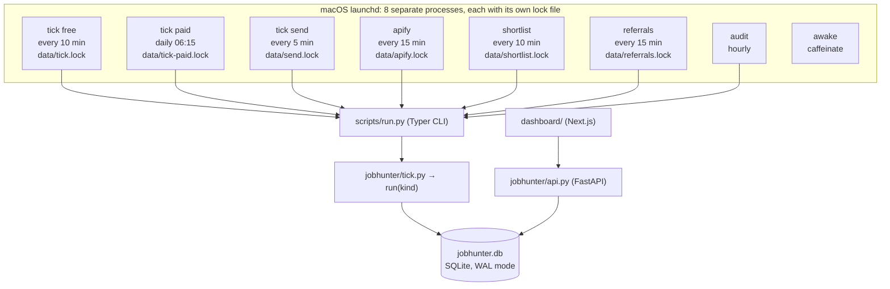
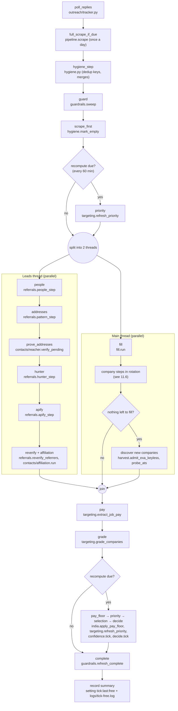
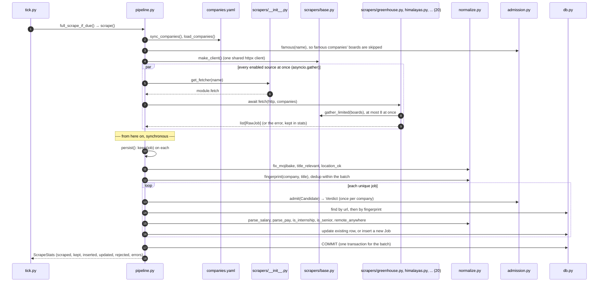
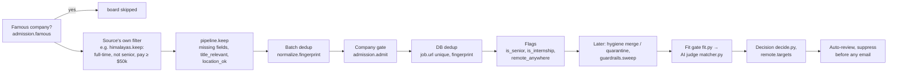

[← 10 Implementation](10-working-implementation.md) · [System design](README.md) · **11 Architecture and code flow**

# 11. Architecture and code flow, file by file

This file follows the code. For each stage it lists which files run, in what order, and what runs in parallel versus one after another. Every function named here exists in the repository.

## 11.1 Architecture at a glance

## 11.2 Concurrency model: what runs in parallel, what runs in order

| Level | What runs at the same time | Where | Why |
|---|---|---|---|
| **Processes** | the 8 launchd jobs run as separate processes | plists in `~/Library/LaunchAgents/com.zonuly.*` | one slow job never blocks sending or buying |
| **Locks** | each kind of job has its own lock file, so two runs of the *same* job never overlap | `tick._Lock` (`fcntl.flock`, non-blocking) | a second run exits immediately instead of queueing |
| **Threads** | inside one free tick: the **leads thread** (people, addresses) runs beside the **main thread** (company fill) | `tick.run_free` → `threading.Thread(target=_leads)` | different websites, so neither waits on the other (one after the other took ~40 min) |
| **Thread pools** | many homepages or boards read at once | `fill.backfill_linkedin` (8 workers), `harvest.probe_ats` / `scrape_roles` (6), `careers.run`, `shortlist` (2), `contacts/reacher` | I/O-bound work: waiting on the network, not the CPU |
| **Async (asyncio)** | all ~20 job sources fetched at once; inside Greenhouse / Lever / Ashby, many company boards at once | `pipeline.scrape_async` → `asyncio.gather`; `scrapers/base.gather_limited` (semaphore of 8) | hundreds of HTTP calls in seconds, capped at 8 per scraper so no site is hammered |
| **Strictly in order** | the steps of a tick inside each thread; `pipeline.persist` (filter → dedup → write); every database write | `tick.run_free`, `pipeline.persist` | SQLite has one writer at a time; ordered steps are easy to reason about and resume |

**The database is the meeting point.** WAL mode means readers (the dashboard) never wait for the writer. Writers queue on SQLite's lock, with a 30 s timeout set in `db.engine`.

## 11.3 Orchestration: one free tick, step by step

`launchd` → `scripts/run.py tick run --kind free` → `tick.run("free")` → `with _Lock():` → `tick.run_free()`

**Why this order:**
- **Replies first,** because a "yes" should never wait behind a scrape.
- **The daily scrape next,** because it is the one thing that must happen each day.
- **Cleanup before new work,** so the next steps read clean data.
- **People and companies in parallel,** because they read different websites.
- **Cheap recomputes last.** They read what this run just wrote, and they run at most hourly because they take about 2.5 minutes.

## 11.4 Scraping, file by file

| Step | File → function | Sync / async | What happens |
|---|---|---|---|
| 1 | `tick.py → full_scrape_if_due()` | sync | runs the full scrape once per local day (a `setting` row remembers the date) |
| 2 | `pipeline.py → scrape()` | sync wrapper | `asyncio.run(scrape_async())` then `persist()` |
| 3 | `pipeline.py → sync_companies(), load_companies()` | sync | seeds companies from `companies.yaml`; drops famous names (`admission.famous`) |
| 4 | `scrapers/base.py → make_client()` | – | one `httpx.AsyncClient` with timeouts, headers, connection limits |
| 5 | `pipeline.py → scrape_async()` | **async, parallel** | `asyncio.gather` over every source from `enabled_sources()` (`config.yaml → sources`) |
| 6 | `scrapers/__init__.py → get_fetcher(name)` | – | registry lookup: name → module → `fetch` |
| 7 | `scrapers/<source>.py → fetch(http, companies)` | **async** | reads one source; ATS scrapers fan out per company with `gather_limited` (8 at a time); returns `list[RawJob]`; a failure is caught and recorded, the others continue |
| 8 | `pipeline.py → persist()` | **sync** | filter, dedup, write (below) |
| 9 | `normalize.py` | sync | `fix_mojibake`, `title_relevant`, `location_ok`, `fingerprint`, `parse_salary`, `parse_pay`, `is_senior`, `is_internship`, `remote_anywhere` |
| 10 | `admission.py → admit()` | sync | company gate, once per company per batch |
| 11 | `db.py` | sync | one session; update or insert; one `COMMIT` at the end; `before_flush` listeners run here |

## 11.5 Filtering: every gate, in the order a posting meets it

| # | Gate | File | Removes |
|---|---|---|---|
| 1 | Famous companies | `admission.famous` (in `scrape_async`) | the board is never read |
| 2 | Source filter | inside each scraper, e.g. `scrapers/himalayas.keep`, `remoteok` tag filter | non-tech, senior, part-time, under-paid postings |
| 3 | Relevance | `pipeline.keep` → `normalize.title_relevant`, `location_ok` | wrong job type, wrong location, rows missing title/url/company |
| 4 | Batch dedup | `normalize.fingerprint` in `persist` | the same role from several boards (keeps the longest description) |
| 5 | Company gate | `admission.admit` | junk names, duplicates, staffing agencies, bogus websites |
| 6 | Stored dedup | `job.url` unique, `job.fingerprint` | re-inserting a known role (it is updated instead) |
| 7 | Hygiene | `hygiene.py` (every tick) | merges duplicate companies, quarantines non-companies |
| 8 | Field checks | `guardrails.py` | values without evidence |
| 9 | Fit | `fit.py`, then `matcher.py` | weak matches never reach the AI judge |
| 10 | Decision | `decide.py`, `remote.py`, `india.pay_proved` | companies not worth the effort (skip, fill_first) |
| 11 | Before mail | `outreach/autoreview.py`, `outreach/suppress.py`, the `before_flush` email guard | unproved addresses, senior roles, opt-outs, repeats |

## 11.6 Company fill (main thread), file by file

`tick.run_free` → `fill.run` (each company completed in turn), then `tick._company_steps()` in **rotation**. A cursor in `setting tick:company_cursor` makes each step get its turn across ticks, inside the companies' share of the time budget.

| Step name | File → function | What it does |
|---|---|---|
| fill | `fill.py → run()`, `company()` | homepage, description, careers page, LinkedIn page for one company at a time |
| funding_rss | `harvest.py → admit_funding_rss()` | new companies from funding news feeds, through the admission gate |
| websites | `enrich.py → find_websites()` | finds the official site of name-only companies (keyless search, then the site must confirm) |
| facts_keyless | `enrich.py → facts_pending()` | funding round, amount, date from free search |
| boards | `harvest.py → probe_ats()`, `scrape_roles()` | which job board a company uses (Greenhouse / Lever / Ashby), then its open roles through `pipeline.persist` |
| careers | `careers.py → run()` | reads careers pages directly (thread pool) |
| revalidate | `referrals.py → revalidate_companies()` | re-checks stale companies |
| verify | `hiring_verify.py → verify_pending()` | does the company's own site back the hiring claim? |
| india_discovery | `india.py → discover()` | new Bengaluru / Hyderabad startups |
| india_jobs | `india_jobs.py → run()` | India job boards |

A failure in any step is written to `company.retry_state` by `backoff.py`. That company is skipped until its next retry time (1, 3, 7, 21, 60 days).

## 11.7 Leads thread (people), file by file

| Step | File → function | What it does |
|---|---|---|
| people | `referrals.py → people_step()` → `contacts/*` (`github_miner`, `team_people`, `linkedin_public`, `site_scraper`, `roles`) | finds employees, classifies their role, inside a time budget |
| addresses | `tick._addresses_step` → `referrals.pattern_step()` | the company's confirmed email pattern, applied only where it is proved |
| prove_addresses | `contacts/reacher.py → verify_pending()` | checks found addresses; only `safe` ones can be stored on `contact.email` |
| hunter | `referrals.py → hunter_step()` | the free monthly Hunter.io lookups |
| apify | `referrals.py → apify_step()` → `apify_queue()` → `remote.targets()` → `actors/fill.fill_company()` → `actors/apify_source.py` | buys People tabs, remote companies first, inside the budget |
| reverify, affiliation | `referrals.reverify_referrers()`, `contacts/affiliation.run()` | is the person still at the company? |

Every contact write passes `db._only_verified_addresses` (the `before_flush` listener).

## 11.8 The other scheduled jobs

| Job | Entry | Files it touches, in order |
|---|---|---|
| send (5 min) | `tick.run_send()` | `outreach/sender.send_due()` (approved mail only, inside the send window, paced per inbox) → `sender.send_email()` → `outreach/suppress.py` → `outreach/ledger.reserve()` → `outreach/gmail.py` (→ `ledger.release()` on failure) |
| apify (15 min) | `tick.run_apify()` | `fill.backfill_linkedin()` (thread pool) → `referrals.apify_step()` → `actors/apify_source.py` → `guardrails.refresh_complete()` |
| shortlist (10 min) | `tick.run_shortlist()` | `shortlist.py`: one shortlisted company completed (fill, people, pay), then drafts → `outreach/autoreview.run()` approves or rejects them |
| referrals (15 min) | `tick.run_referrals()` | `referrals.run_cycle()` with its own lock |
| paid (06:15) | `tick.run_paid()` | `harvest.admit_exa()` (discovery) → `probe_ats` / `scrape_roles` → `enrich.facts_pending()` → `enrich.enrich_pending()` (descriptions, stories via `llm.py`) → `levels.lookup_pending()` → `targeting.grade_companies()` → `kg/sync.sync_all()` + `kg/brief.write()`; each capped channel paced by `tick.paced()` |
| audit (hourly) | `scripts/run.py audit run` → `audit.py` | fill rates now vs 1 h vs 24 h, rejects by reason |

## 11.9 A dashboard request, file by file
`dashboard/proxy.ts` (session check) → `dashboard/app/(app)/companies/page.tsx` → `dashboard/next.config.ts` (`/zapi/*` rewrite) → `jobhunter/api.py` middleware (`access.refusal`, `snapshot_cache.SnapshotCache`) → handler `list_companies()` → `db.get_session()` → JSON back.

## 11.10 Why it is built this way

| Choice | Reason |
|---|---|
| Separate processes per job kind | a slow scrape never delays sending; each has its own lock |
| Two threads inside a tick | people search and company fill hit different sites; run one after the other, a tick took about 40 minutes |
| Async for scraping | waiting on hundreds of HTTP calls; async does it in one thread with little memory |
| Bounded concurrency (8) | fast without overloading anyone's site, so no bans |
| Synchronous persist, one writer | SQLite allows one writer; ordered writes are simple and safe |
| Time budgets and rotation | every step gets a turn; a run always finishes in minutes |
| Gates from cheap to expensive | free filters remove most rows before any paid or slow step |

---
[← 10 Implementation](10-working-implementation.md) · [System design](README.md)
