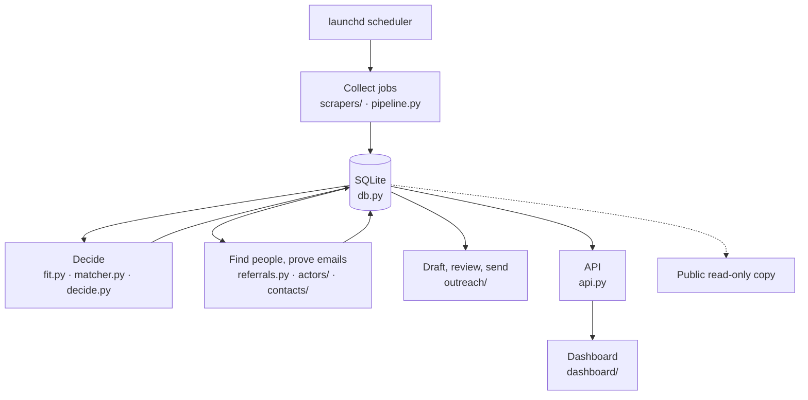

# ZoNuLy System Design (Low-Level Design)

How ZoNuLy is designed, one topic per file. Every claim points to a real file in this repository. The diagrams are Mermaid, which GitHub draws automatically.

| # | Topic | What it covers |
|---|---|---|
| 1 | [Requirement analysis](01-requirement-analysis.md) | actors, use cases, functional and non-functional requirements |
| 2 | [Class diagram](02-class-diagram.md) | entities, attributes, methods, relationships, multiplicities |
| 3 | [Object-oriented design](03-object-oriented-design.md) | abstraction, encapsulation, inheritance, polymorphism, interfaces |
| 4 | [SOLID principles](04-solid-principles.md) | where each of the five principles is applied |
| 5 | [Design patterns](05-design-patterns.md) | creational, structural and behavioural patterns, and why |
| 6 | [Sequence and activity diagrams](06-sequence-and-activity-diagrams.md) | flow of control for the core use cases |
| 7 | [API and interface design](07-api-and-interface-design.md) | layers, endpoints, request and response shapes, signatures |
| 8 | [Database schema](08-database-schema.md) | tables, keys, relationships, indexes |
| 9 | [Error handling and edge cases](09-error-handling-and-edge-cases.md) | validation, failures, concurrency |
| 10 | [Working implementation](10-working-implementation.md) | how to run it, demo path, tests, deployment |

## The system in one picture

## Codebase size (tracked files)

| Part | Files | Lines |
|---|---:|---:|
| Python backend (`jobhunter/`) | 149 | 54,340 |
| Python scripts (`scripts/`) | 16 | 5,415 |
| Tests (`tests/`, about 630 cases) | 33 | 6,561 |
| Dashboard, TypeScript + CSS (`dashboard/`) | 108 | 23,218 |
| **All code** | **306** | **89,534** |
